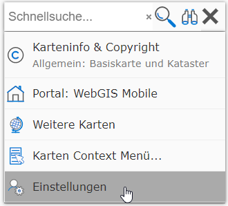
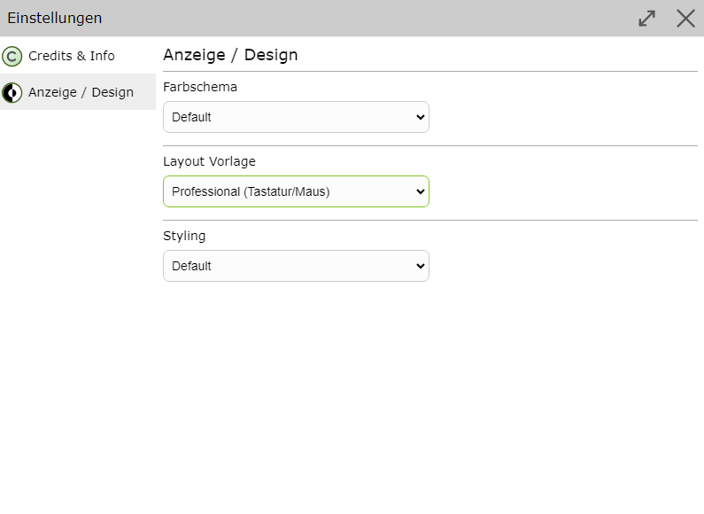

Benutzeroberfläche
==================

Nach dem Öffnen einer Karte erscheint der Kartenviewer in folgender Form:

.. image:: img/viewer1.png

Es müssen in einer Karte nicht alle hier gezeigten Elemente sichtbar sein. Die einzelnen Elemente werden vom Karten Administrator so festgelegt,
dass eine effiziente Bedienung für die jeweilige Anwendung möglich ist. 

Auf mobilen Geräten kann sich das Erscheinungsbild entsprechend anpassen:

.. image:: img/viewer2.png
    :width: 300px
    :height: 500px

Die Benutzeroberfläche kann bezüglich Anzeige/Design angepasst werden. Dazu geht man in die Einstellungen unter *Anzeige/Design*.

| Hier lassen sich *Farbschema*, *Layout Vorlage* und *Styling* anpassen.
| Bei der Layout Vorlage kann zwischen *Mobile (Standard)* und *Desktop (Professional)* gewählt werden. Die Desktop-Vorlage bietet speziell für Anwender, die viel Editieren, eine benutzerfreundlichere Oberfläche.

.. _ui-detachable-windows:

Bereiche in eigenem Fenster
---------------------------

.. versionadded:: 9.26.4104

In der Desktop-Vorlage können die *Werkzeugleiste* und die *Abfrageergebnisse* (Tabelle) in ein
eigenes Fenster abgekoppelt werden, sofern der Karten Administrator diese Funktion aktiviert hat
und der Browser sie unterstützt (Chrome, Edge). Dazu klickt man auf das Symbol zum Abkoppeln im
jeweiligen Bereich. Das Fenster kann frei verschoben und z. B. auf einem zweiten Bildschirm
vergrößert werden.

- In der abgekoppelten Werkzeugleiste werden alle Werkzeuge auf einer Seite angezeigt, die
  bisherigen Tabs sind Überschriften.
- Zurückholen: über das Symbol in der Titelzeile des Bereichs, über den Platzhalter im
  Hauptfenster oder durch Schließen des Fensters.
- Blendet ein Werkzeug (z. B. *Karte drucken*) die Werkzeugleiste aus, erscheint im Fenster ein
  Hinweis. Über die Schaltfläche *Aktives Werkzeug schließen* wird das Werkzeug beendet und die
  Werkzeugleiste wieder angezeigt.
- Beim nächsten Aufruf der Karte wird gefragt, ob die zuletzt abgekoppelten Bereiche
  wiederhergestellt werden sollen.  