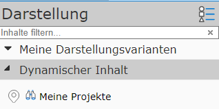
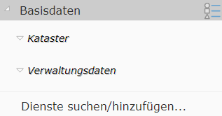
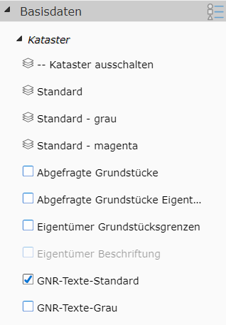
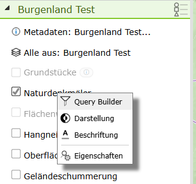
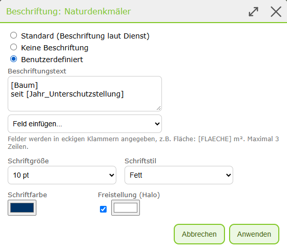
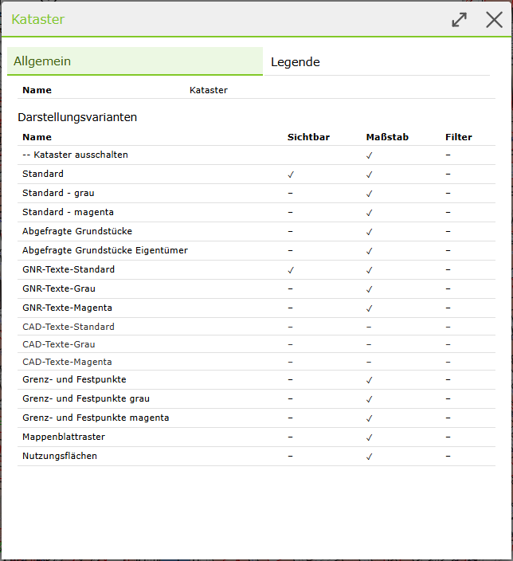

.. sectnum::
    :start: 3

Darstellung und Karteninhalte
=============================

Je nach Karte gibt es unterschiedliche Karteninhalte. So ist beispielsweise eine Karte mit Katasterdaten und eine andere mit Daten aus der Flächenwidmung denkbar.
Natürlich könnte eine Karte auch beide Themenbereiche abdecken. Welche Inhalte in einer Karte sind, bestimmt der Kartenautor. Hier werden nur die allgemeinen
Konzepte beschrieben, wie die Darstellung von Karteninhalten organisiert werden kann und der Anwender diese beeinflussen kann.

Die Karteninhalte werden im Kartenviewer hauptsächlich im Bereich **Darstellung** festgelegt (am Desktop in der Regel im linken *Frame*, auf mobilen Geräten am unteren Bildschirmrand - siehe Übersicht)

Es gibt in der Regel unterschiedliche Arten von Geodaten die auch im Kartenviewer auf unterschiedliche Art und Weise bedient werden können:

Dynamische Inhalte
------------------

Dynamische Inhalte sind meist sehr spezifische Daten und nicht in jeder Karte vorhanden. Sie werden in der Liste der Darstellungsinhalte in der Regel ganz oben angezeigt und können extra ein- oder ausgeblendet werden. 
Die dynamischen Inhalte werden in der Karte als klickbare Marker dargestellt. Es kann von diesen Themen immer nur eines aktuell in der Karte dargestellt werden. 

Dynamische Inhalte dienen in der Regel dazu, sehr dynamische Themen (die sich schnell ändern können) in einer Karte bereitzustellen. 
Da sie in der Karte als Marker dargestellt werden, verhalten sie sich wie die Ergebnisse einer Abfrage/Suche und können somit auch als vordefinierte Abfragen verstanden werden.
Abfragen/Suchen werden in einem späteren Abschnitt noch genauer behandelt.

Hintergrund (Basemaps)
----------------------

Diese Daten sind eher statisch und dienen hauptsächlich der Orientierung in der Karte. Sie liegen in der Regel in der Karte unter allen anderen Daten (Hintergrund). 
Meist handelt es sich bei diesen Hintergrunddaten um Luftbilder oder Orts- und Straßenkarten. Die Daten sind meistens flächenfüllend, daher kann immer nur ein 
Hintergrund gleichzeit angezeigt werden.

Im Darstellungsbereich des Kartenviewers erscheinen die Hintergrund Karten etwa folgendermaßen:

.. image:: img/basemap1.png

Mittels Klick auf eine der Kacheln wird der Hintergrund gewechselt. Der Button *Kein Hintergrund* setzt alle Hintergrund Karten auf *unsichtbar*.
Gibt es mehr als drei mögliche Hintergrundkarten, kann die Kachelansicht mit dem Pfeilsymbol (Pfeil nach unten unter den Kacheln) erweitert werden.

Die *xx% Buttons* geben die Transparenz des dargestellten Hintergrundes an. 

.. note:: Durch die Transparenz erscheint der Hintergrund "heller", was für mache Anwendungen bei der Überlagerung mit Fachdaten zu einem bessern Kontrast führen kann.

Optionale Hintergrund Karten (sogenannte *Overlay*-Karten) können - falls vorhanden - über den eigentliche Hintergrund Karte gelegt werden (hier *Strassen Farbe*).
Das macht beispielsweise Sinn, wenn über eine Luftbild Karte zur Orientierung noch Straßen und Straßennamen gelegt werden sollten: 

.. image:: img/basemap2.png

.. note::
   Da Hintergrund Karten in der Regel statische Daten enthalten, liegen sie als sogenannte Karten-Kacheln vor. Diese Kacheln existieren bereits vorberechnet für alle Maßstäbe auf dem Server,
   was die Darstellung besonders performant macht und beim Navigieren in der Karte für *flüssige* Übergänge sorgt. 

Darstellungsvarianten (Fachdaten)
---------------------------------

Dabei handelt es sich um die für eine Kartenanwendung eigentlich entscheidenden Daten. Im Gegensatz zu den Hintergrund Karten liegen diese Daten in der Regel nicht vorprozessiert für alle Maßstäbe vor, sondern werden
für jeden Kartenausschnitt individuell auf Basis der Anforderungen des Anwenders erstellt. Damit gleichen diese Daten eher den *Dynamischen Inhalten* (siehe oben), mit dem Unterschied, dass hier in der Karte 
nicht nur *klickbare* Kartenmarker angezeigt werden. Vielmehr erscheinen diese Daten als kartographisch aufbereitetes Kartenbild, das über die Hintergrundkarten gelegt wird.

Aus dieser Tatsache ergibt sich natürlich, dass diese Daten nicht so *flüssig* dargestellt werden, wie beispielsweise die vorberechneteten Hintergrundkarten Kacheln. Dafür kann der Anwender bei diesen Daten
wesentlich mehr Einfluss auf Inhalt und Darstellung nehmen. So kann der Anwender entscheiden, welche Datenebenen angezeigt werden sollten und welche nicht. Unterschiedlichste Datenebenen können mit Hilfe von 
Darstellungsvarianten beliebig kombiniert werden.

.. note::
   Aufgrund der Tatsache, dass die *Fachdaten* Kartenbilder dynamisch und individuell für jede Anwenderanfrage erzeugt werden, kommt es vor, dass die Darstellung nach Änderen des Kartenausschnittes 
   einige Augenblicke dauern kann. Die Performance dieser Dienste ist abhängig von der Anzahl der dargestellten Daten und der kartographischen Komplexität der Karten. Der Kartenviewer zeigt daher
   in einer Statusleiste (links unten) eine Fortschrittsanzeige an:

   .. image:: img/hourglass1.png

   Sind alle Daten geladen, verschwindet die Fortschrittsanzeige und an ihrer Stelle wird der aktuelle Maßstab und der Maßstabsbalken angezeigt:
   
   .. image:: img/scale1.png

   **Tipp:** ein Klick auf den Maßstab öffnet einen Dialog, in dem der aktuelle Kartenmaßstab definiert werden kann.

Die Darstellungsvarianten sind im Kartenviewer im *Darstellungs-Frame* in aufklappbaren Containern organisiert. Welche Darstellungsvarianten verfügbar sind, ist vom Inhalt der Karte und den
jeweiligen Berechtigungen abhängig.

In den Containern befinden sich für jede Themengruppe die *schaltbaren* Darstellungsvarianten. In der Abbildung ist auch ersichtlich, dass diese Darstellungsvarianten auch im Container (Basisdaten) noch einmal 
in Gruppen unterteilt werden können (Kataster, Verwaltungsdaten). Spätestens nach dem Öffnen dieser Gruppe, erscheinen die *klickbaren* Darstellungsvarianten:

Die Darstellungsvarianten können mit unterschiedlichen Symbolen angezeigt werden:

* **Layer-Stapel Symbol:** Klickt man auf die Darstellungsvariante, werden die entsprechenden Layer sichtbar geschalten. Ein Klick auf einem Layer-Stapel betrifft in der Regel mehrere Layer. Andere Layer, die für diese Ansicht nicht sinnvoll sind, werden ausgeblendet. Im Beispiel hier wird beispielsweise der Kataster mit grauen Farben ausgeblendet, wenn man auf die Darstellungsvariante mit Kataster in "Magenta" Farben klickt.

* **Checkbox Symbol:** Über das *Häkchen* Symbol, lassen sich optionale Darstellungsvarianten ein- oder ausblenden. Auch hinter dieser Darstellungsvariante können sich mehrere Datenebenen befinden, die logisch zu einer Darstellungsvariante gruppiert wurden.

* **Optionbox Symbol:** Über ein *Ringerl* Symbol können (gleich wie mit dem *Häkchen* Symbol) Themen optional eingeblendet werden. Der Unterschied ist hier, dass sich diese Themen gegenseitig ausschließen. Es kann nur eine *Optionbox* innerhalb einer Gruppe aktiv sein.

.. note::
   Wie die Darstellungsvarianten organisiert sind, und welche Datenebenen Sie einblenden, wird vom Kartenautor definiert. Die Darstellungsvarianten sollten dem Anwender helfen, möglichst einfach ans Ziel zu kommen,
   ohne genaue Kenntnis über die dahinterliegende Datenstruktur haben zu müssen. Der Anwender möchte beispielsweise nur die Möglichkeit haben, den Kataster einzublenden. Es ist ihm aber egal,
   ob das die Themen Grundstückgrenzen, Nutzungsgrenzen, Gebäudegrenzen, Nutzungssymbole, Grundstücksnummern, ... betrifft.

.. note::
   Einige Darstellungsvarianten werden in *grau* aufgelistet. Das bedeutet, dass die Themen Ebenen, die damit eingeblendet werden können, im aktuellen Maßstab nicht sichtbar sind (ein Klick wird in der Karte nicht sofort die
   gewünschten Themen anzeigen). Zoomt man weiter in die Karte hinein, werden diese Themen irgendwann sichtbar bzw. die Darstellungsvariante erscheint nicht mehr *grau*.

Der Grund für die maßstabsabhängige Darstellung ist in der Regel, dass nicht alle Themen in jedem Maßstab Sinn ergeben. Grundstücksgrenzen machen etwa in einem sehr kleinen Maßstab (zB komplettes Bundesland) keinen Sinn
und würden den Kartenaufbau nur verlangsamen.

.. _toc-context-menu:

Kontextmenü im Inhaltsverzeichnis
---------------------------------

.. versionadded:: 9.26.4104

Jede Darstellungsvariante und jede Gruppe im Inhaltsverzeichnis besitzt ein Kontextmenü. Es kann auf zwei Arten geöffnet werden:

* **Rechte Maustaste** auf die Darstellungsvariante bzw. auf den Titel der Gruppe.
* **Menü-Symbol** (drei Striche): Es erscheint rechts, sobald man mit der Maus über eine Darstellungsvariante oder eine Gruppe fährt.

.. image:: img/toc_burger.png

Auf Touch-Geräten wird das Kontextmenü durch längeres Drücken auf einen Eintrag geöffnet.

Das Kontextmenü einer Darstellungsvariante enthält, je nach Darstellungsvariante:

* **Metadaten:** Öffnet die Metadaten der Darstellungsvariante (nur wenn vom Kartenautor hinterlegt).
* **Query Builder:** Öffnet den Query Builder, mit dem die Layer der Darstellungsvariante gefiltert werden können (nur wenn die Layer abfragbar sind).
  Bezieht sich die Darstellungsvariante auf mehrere Layer, kann im Untermenü ein einzelner Layer gewählt werden. **Alle** öffnet den Query Builder für alle Layer der Darstellungsvariante.
* **Filter zurücksetzen:** Entfernt alle Filter (zB aus dem Query Builder) der Layer dieser Darstellungsvariante (nur wenn Filter gesetzt sind).
* **Darstellung:** Ändert die Darstellung (Symbolik) eines Layers (siehe :ref:`toc-user-renderer`).
* **Beschriftung:** Ändert die Beschriftung eines Layers (siehe :ref:`toc-user-labeling`).
* **Eigenschaften:** Öffnet den Eigenschaften-Dialog (siehe unten).

.. image:: img/toc_menu_querybuilder.png

**Darstellung** und **Beschriftung** werden nur angeboten, wenn der Kartenautor das für den Dienst erlaubt hat. Bezieht sich die Darstellungsvariante auf mehrere Layer,
wird der Layer, wie beim Query Builder, über ein Untermenü gewählt.

.. _toc-badges:

Hinweis-Symbole (Badges)
~~~~~~~~~~~~~~~~~~~~~~~~

.. versionadded:: 9.26.4104

Rechts neben dem Namen einer Darstellungsvariante zeigt ein kleines, abgerundetes Feld (Badge) an, dass für die Darstellungsvariante etwas Besonderes gilt:

* Farbschema-Symbol: eine benutzerdefinierte Darstellung ist aktiv,
* Beschriftungs-Symbol: eine benutzerdefinierte Beschriftung ist aktiv,
* Trichter: ein Filter (zB aus dem Query Builder) ist gesetzt,
* *i*: für die Darstellungsvariante sind Metadaten vorhanden.

Fährt man mit der Maus über das Badge, wird die Bedeutung der Symbole als Tooltip angezeigt.

.. image:: img/toc_badges.png

Ein Klick auf das Badge schaltet die Darstellungsvariante **nicht** ein oder aus, sondern öffnet das Kontextmenü. Dort sind die passenden Einträge zu finden,
zB **Metadaten**, **Filter zurücksetzen**, **Darstellung zurücksetzen** oder **Beschriftung zurücksetzen**.
Ist der Name einer Darstellungsvariante sehr lang, wird er gekürzt, damit das Badge sichtbar bleibt.

.. _toc-user-renderer:

Darstellung
~~~~~~~~~~~

.. versionadded:: 9.26.4104

Über den Menüpunkt **Darstellung** kann die Symbolik eines Layers für die eigene Karte geändert werden. Im Dialog stehen zwei Optionen zur Auswahl:

* **Standard (Darstellung des Dienstes):** Der Layer wird so dargestellt, wie er im Dienst definiert ist.
* **Benutzerdefiniert:** Es wird eine neue Darstellung für den Layer festgelegt.

.. image:: img/renderer_default.png

Für eine benutzerdefinierte Darstellung wird zuerst die **Darstellungsart** gewählt:

* **Einheitliches Symbol:** Alle Objekte des Layers werden mit demselben Symbol dargestellt. Je nach Geometrie (Punkt, Linie, Fläche) können
  Farbe, Größe, Symbol, Linienart und -stärke bzw. Füllung und Rand eingestellt werden.

  .. image:: img/renderer_simple.png

* **Eindeutige Werte:** Die Objekte werden nach den Werten eines Feldes unterschiedlich dargestellt. Nach Auswahl des **Feldes** können über **Werte laden**
  die im Layer vorkommenden Werte übernommen oder mit **Wert hinzufügen** einzelne Werte händisch eingetragen werden. Für jeden Wert kann das Symbol
  und eine **Beschriftung (Legende)** festgelegt werden. Mit **Alle anderen Werte** werden auch Objekte dargestellt, deren Wert in der Liste nicht vorkommt.

  .. image:: img/renderer_uniquevalue.png

* **Klassen (Wertebereiche):** Die Objekte werden nach Wertebereichen eines numerischen Feldes dargestellt. Nach Auswahl von **Feld**, **Anzahl Klassen**
  und **Farbverlauf** werden über **Klassen berechnen** gleich große Klassen zwischen dem kleinsten und größten Wert des Feldes erzeugt.
  Die Klassengrenzen, Symbole und Beschriftungen können danach noch angepasst werden.

  .. image:: img/renderer_classbreaks.png

Zur Auswahl stehen dieselben Felder, nach denen auch mit dem Query Builder gefiltert werden kann.
Mit **Anwenden** wird die Karte mit der neuen Darstellung gezeichnet. Auch die Legende zeigt die benutzerdefinierte Darstellung an;
bei *Eindeutige Werte* und *Klassen* wird das verwendete Feld in Klammern hinter dem Layernamen angezeigt, damit erkennbar ist, wonach klassifiziert wurde.

Ist eine benutzerdefinierte Darstellung aktiv, wird der Menüpunkt **Darstellung** mit einem Häkchen markiert und es erscheint zusätzlich der Menüpunkt
**Darstellung zurücksetzen**, mit dem wieder die Standard-Darstellung des Dienstes verwendet wird.

.. image:: img/toc_menu_userrenderer_active.png

Benutzerdefinierte Darstellungen werden mit der Karte gespeichert und beim Laden der Karte wiederhergestellt.

.. _toc-user-labeling:

Beschriftung
~~~~~~~~~~~~

.. versionadded:: 9.26.4104

Über den Menüpunkt **Beschriftung** kann die Beschriftung eines Layers geändert werden. Im Dialog stehen drei Optionen zur Auswahl:

* **Standard (Beschriftung laut Dienst):** Der Layer wird so beschriftet, wie es im Dienst eingestellt ist.
* **Keine Beschriftung:** Der Layer wird nicht beschriftet, auch wenn im Dienst eine Beschriftung eingestellt ist.
* **Benutzerdefiniert:** Es wird eine eigene Beschriftung festgelegt.

.. image:: img/labeling_default.png

Bei einer benutzerdefinierten Beschriftung wird der **Beschriftungstext** eingegeben. Felder werden in eckigen Klammern angegeben,
zB ``Fläche: [FLAECHE] m²``. Über **Feld einfügen...** kann ein Feld an der aktuellen Position in den Text eingefügt werden. Zur Auswahl stehen
dieselben Felder, nach denen auch mit dem Query Builder gefiltert werden kann. Der Text darf aus maximal 3 Zeilen und 200 Zeichen bestehen.

Weiters können **Schriftgröße**, **Schriftstil** (Normal, Fett, Kursiv, Fett kursiv), **Schriftfarbe** und eine **Freistellung (Halo)** eingestellt werden.

Mit **Anwenden** wird die Karte mit der neuen Beschriftung gezeichnet. Ist eine benutzerdefinierte Beschriftung aktiv, wird der Menüpunkt **Beschriftung**
mit einem Häkchen markiert und es erscheint zusätzlich der Menüpunkt **Beschriftung zurücksetzen**.
Benutzerdefinierte Beschriftungen werden ebenfalls mit der Karte gespeichert.

Beispiel: Naturdenkmäler mit benutzerdefinierter Darstellung (Klassen nach Jahr der Unterschutzstellung) und Beschriftung ``[Baum]`` / ``seit [Jahr_Unterschutzstellung]``:

.. image:: img/map_userrenderer_labeling.png

.. note::
   Die Beschriftung ersetzt das frühere Werkzeug *Themen beschriften*.

Das Kontextmenü einer Gruppe enthält die **Metadaten** der Gruppe (falls vorhanden) und die **Eigenschaften**:

.. image:: img/toc_menu_group.png

.. _toc-properties:

Eigenschaften
~~~~~~~~~~~~~

Der Eigenschaften-Dialog fasst die wichtigsten Informationen zu einer Darstellungsvariante in mehreren Reitern zusammen:

* **Allgemein:** Name, Beschreibung und Dienste der Darstellungsvariante sowie eine Liste aller Layer mit

  * *Sichtbar:* ob der Layer aktuell eingeschaltet ist,
  * *Maßstab:* in welchem Maßstabsbereich der Layer dargestellt wird (zB *ab 1:10.000*). Layer, die im aktuellen Maßstab nicht sichtbar sind, werden grau angezeigt.
    Über **Auf sichtbaren Maßstab zoomen** wird in den nächstgelegenen Maßstab gezoomt, in dem der Layer sichtbar ist (der Kartenmittelpunkt bleibt erhalten),
  * *Abfragbar:* ob für den Layer eine Abfrage existiert,
  * *Filter:* ob für den Layer aktuell ein Filter (zB aus dem Query Builder) gesetzt ist. Über **Filter entfernen** kann der Filter für diesen Layer wieder entfernt werden.
    Sind mehrere Layer gefiltert, können mit **Alle Filter dieser Darstellungsvariante entfernen** alle Filter auf einmal entfernt werden.

  .. image:: img/toc_props_general.png

* **Legende:** Die Legende aller Layer der Darstellungsvariante, auch jener, die aktuell nicht sichtbar sind.
* **Info & Copyright:** Beschreibung und Copyright der Dienste.
* **Technisch:** Nur für Kartenautoren sichtbar. Zeigt die ID der Darstellungsvariante (*dvid*), die ID und den Typ der Dienste und für jeden Layer
  die ID, den vollständigen Layernamen, den minimalen/maximalen Maßstab und die ID der Abfrage. Über das Kopier-Symbol, das beim Überfahren einer Zeile erscheint,
  können die Werte in die Zwischenablage kopiert werden.

  .. image:: img/toc_props_technical.png

Bei einer Gruppe zeigt der Eigenschaften-Dialog den Namen der Gruppe, die enthaltenen Darstellungsvarianten (sichtbar, im aktuellen Maßstab sichtbar, gefiltert)
und eine gemeinsame Legende aller Layer der Gruppe:

Tipps und Tricks
----------------

Karten mit sehr vielen Fachendaten, können recht umfangreiche Darstellungsvarianten Bäume haben. Um eine Darstellungsvariante zu finden, sind dabei je nach Übung mehrere Klicks notwendig.
Um diesen Vorgang zu beschleunigen, kann nach Darstellungsvarianten im Baum gesucht werden. Dazu gibt es direkt über dem obersten Container (nur Desktop Variante) ein kleines Eingebfeld 
mit der Beschriftung *Inhalte suchen...*

Gibt man hier einen Wert ein, verschwinden alle nicht relevanten Darstellungsvarianten und *Container* und alle relevanten Gruppen werden aufgeklappt dargestellt.

.. image:: img/presentations3.png

Klickt man auf die gefundene Darstellungsvariante, wird diese aktiv und der Darstellungsvarianten Baum wird wieder in der ursprünglichen Form angezeigt.
Man kann ebenfalls auf eine relevante Gruppe klicken, um diese dann im ursprünglichen Baum zu öffen und die darunter liegenden Darstellungsvarianten anzuzeigen.

Möchte man den Darstellungsvarianten Baum einfach wieder in der ursprünglichen Form darstellen, muss der Inhalte aus dem *Inhalte suchen* Eingabefeld gelöscht werden.

