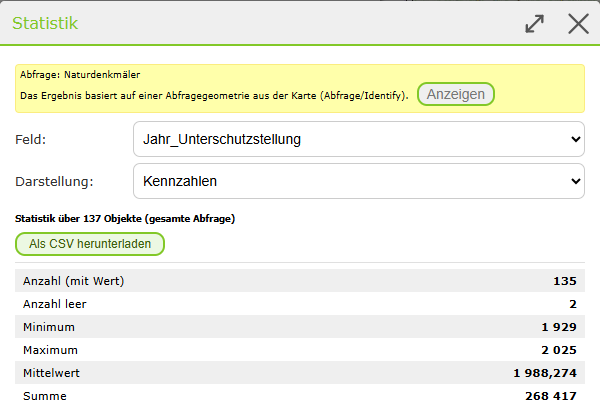
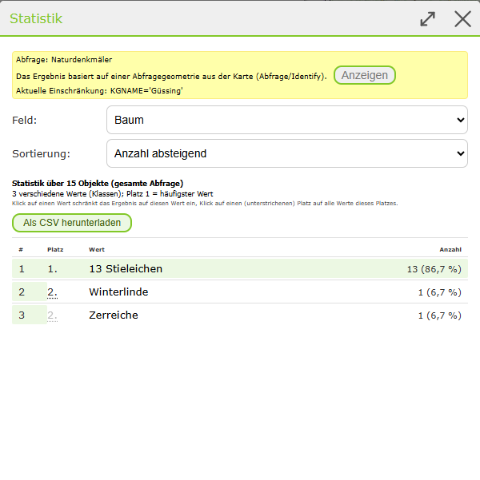

Ergebnisse im Desktop-Layout
============================

Die Ergebnis-Tabelle im Desktop-Layout unterscheidet sich geringfügig von der Tabelle im Mobile-Layout.

Detailergebnisse
----------------

Die Tabelle für Detailergebnisse wird gleich dargestellt, wie wenn man sich mehrere Ergebnisse als Tabelle anzeigen lässt. 

.. image:: img/tabelle_detailergebnisse.png

Ergebnisliste
-------------

.. image:: img/tabelle_liste_ergebnisse.png
    :width: 800px
    :height: 200px   

Tabellen-Werkzeuge
------------------

In den Tabellen stehen folgende Tabellen-Werkzeuge zur Verfügung:

.. image:: img/icons_tabelle.png

Die Funktionen der Tabellen-Werkzeuge sind ident mit denen im Mobile-Layout.

Selektiert man in einer Tabelle mit mehreren Ergebnissen Einträge, so kommen zwei Tabellen-Werkzeuge hinzu. Diese dazu dienen, entweder die nicht ausgewählten Ergebnisse zu entfernen oder das selektierte Ergebnis aus der Liste zu löschen.   

.. image:: img/nicht_ausgew_entfernen.png

.. image:: img/ausgew_entfernen.png

.. _results-query-restriction:

Abfrageergebnis einschränken
~~~~~~~~~~~~~~~~~~~~~~~~~~~~

.. versionadded:: 9.26.4104

Liefert eine Abfrage oder ein Identify zu viele Ergebnisse, kann das Ergebnis über das Tabellen-Werkzeug **Einschränken** weiter eingeschränkt werden.
Dabei öffnet sich der :ref:`Query Builder <toc-querybuilder>`, in dem Bedingungen (**Feld**, **Operator**, **Wert**) für die Ergebnisse festgelegt werden.

Mit **Anwenden** wird die ursprüngliche Abfrage erneut ausgeführt. Berücksichtigt werden dabei die Abfragegeometrie (zB Identify-Punkt, Rechteck oder Puffer)
und die Eingaben der Detailsuche, ergänzt um die Bedingungen aus dem Query Builder. Die Tabelle zeigt danach nur noch die passenden Ergebnisse.

* Im Query Builder wird angezeigt, woher das Ergebnis stammt, zB aus einer Abfragegeometrie oder einer Detailsuche mit den eingegebenen Werten.
  Über **Anzeigen** wird die Abfragegeometrie kurz in der Karte dargestellt.
* Ist ein Ergebnis eingeschränkt, wird das in der Tabelle mit einem Hinweis angezeigt. Die Einschränkung kann über das **×** im Hinweis oder über
  **Einschränkung entfernen** im Query Builder wieder aufgehoben werden. Dabei wird die ursprüngliche Abfrage ohne Einschränkung erneut ausgeführt.
* Bei langsamen Diensten wird während der Abfrage ein Ladesymbol angezeigt; die Schaltflächen können in dieser Zeit nicht erneut geklickt werden.
* Findet die Abfrage mit den Bedingungen keine Ergebnisse (oder ist eine Bedingung für das Feld ungültig), wird ein Hinweis angezeigt.
  Der Query Builder bleibt mit den eingegebenen Bedingungen geöffnet und die Tabelle bleibt unverändert.
* Wurde die Tabelle über das Kontextmenü im Inhaltsverzeichnis geöffnet (siehe :ref:`toc-table`), basiert das Ergebnis auf dem gesamten
  Datenbestand des Layers (inkl. aktiver Darstellungsfilter); das wird im Query Builder ebenfalls angezeigt.

.. note::
   Die Einschränkung wirkt nur auf das Abfrageergebnis in der Tabelle. Sie ist **kein Darstellungsfilter**, die Darstellung des Layers in der Karte bleibt unverändert.
   Das Werkzeug steht nur zur Verfügung, wenn für den Dienst der Query Builder erlaubt ist und Felder dafür freigegeben sind.

.. _results-query-statistics:

Statistik zum Abfrageergebnis
~~~~~~~~~~~~~~~~~~~~~~~~~~~~~

.. versionadded:: 9.26.4104

Über das Tabellen-Werkzeug **Statistik** erhält man einen Überblick über ein Feld des Abfrageergebnisses, zB wie viele Objekte es je Material gibt
oder welches das älteste bzw. jüngste Baujahr ist. Ein Export nach Excel ist dafür nicht mehr notwendig.

.. image:: img/statistik_werkzeug.png

Die Statistik wird vom Dienst über die **gesamte Abfrage** berechnet, nicht nur über die in der Tabelle geladenen Objekte. Sie ist damit auch dann korrekt,
wenn die Abfrage mehr Treffer liefert, als in der Tabelle angezeigt werden. Berücksichtigt werden die Abfragegeometrie, die Eingaben der Detailsuche
und eine eventuell vorhandene :ref:`Einschränkung <results-query-restriction>`.

Im Dialog wird das **Feld** ausgewählt (angeboten werden die für den Query Builder freigegebenen Felder) und die **Darstellung**:

**Kennzahlen** (Zahlen- und Datumsfelder): Anzahl der Objekte mit Wert, Anzahl leer, Minimum und Maximum, bei Zahlenfeldern zusätzlich Mittelwert und Summe.

**Anzahl je Wert** (Zahlen- und Textfelder, bei Textfeldern immer): Die Objekte werden nach den Werten des Feldes gruppiert. Über der Liste wird angezeigt, wie viele verschiedene Werte (Klassen) es gibt.

.. image:: img/statistik_gruppen.png

Die Liste hat folgende Spalten:

* **#**: fortlaufende Nummer der Zeile.
* **Platz**: Rang des Wertes nach seiner Anzahl, Platz 1 ist der häufigste Wert. Werte mit gleicher Anzahl haben den gleichen Platz,
  der nächste Platz wird entsprechend übersprungen (zB 1, 2, 2, 4). Wiederholt sich ein Platz, wird er abgeschwächt dargestellt.
* **Wert**: der Wert des Feldes. Leere Werte werden als *(leer)* angezeigt.
* **Anzahl**: Anzahl der Objekte mit diesem Wert und deren Anteil am gesamten Ergebnis.

Über **Sortierung** kann die Liste nach der Anzahl absteigend (Standard, Platz 1 steht oben) oder aufsteigend sortiert werden.

Liefert der Dienst nicht alle Werte (die Anzahl der Werte ist durch das Limit des Dienstes beschränkt), wird unter der Liste angezeigt,
wie viele Objekte weitere, nicht aufgelistete Werte haben.

Mit **Als CSV herunterladen** wird die angezeigte Statistik als CSV-Datei (Trennzeichen ``;``) heruntergeladen, zB zur Weiterverarbeitung in Excel.

Ergebnis über die Statistik einschränken
^^^^^^^^^^^^^^^^^^^^^^^^^^^^^^^^^^^^^^^^

In der Darstellung **Anzahl je Wert** kann das Abfrageergebnis direkt aus der Statistik eingeschränkt werden:

* Klick auf einen **Wert**: Das Ergebnis wird auf alle Objekte mit diesem Wert eingeschränkt (zB ``KGNAME = Güssing``).
* Klick auf einen (unterstrichenen) **Platz**: Das Ergebnis wird auf alle Werte dieses Platzes eingeschränkt (zB ``KGNAME in (Wert1, Wert2, ...)``).

Die Tabelle zeigt danach nur noch die passenden Objekte und einen Hinweis auf die Einschränkung:

.. image:: img/statistik_einschraenkung.png

Ist bereits eine Einschränkung vorhanden, wird die neue Bedingung mit **AND** ergänzt. So kann das Ergebnis schrittweise weiter eingegrenzt werden.
Die Statistik zeigt dabei die aktuelle Einschränkung an:

Im Query Builder (Werkzeug **Einschränken**) können einzelne Bedingungen über das **×** wieder entfernt werden, zB um nach einem anderen Wert einzuschränken.
Mit **Anwenden** wird das Ergebnis mit den verbleibenden Bedingungen neu abgefragt.

.. image:: img/statistik_querybuilder.png

.. note::
   Die Statistik steht nur für Layer von ArcGIS-Diensten zur Verfügung, die Statistikabfragen unterstützen, und nur, wenn für den Dienst der Query Builder erlaubt ist.
   Für Datumsfelder werden nur die Kennzahlen angezeigt. Eine Einschränkung über einen Platz ist nicht möglich, wenn dieser leere Werte oder Werte mit Komma enthält
   oder mehr als 1000 Werte umfasst.

Tabellen-Tabs 
--------------

Ein weiterer Unterschied zum Mobile-Layout ist das Vorhandensein von Tabs. Je Abfragethema öffnet sich ein Tab. Rechts von der Tab-Bezeichnung steht die Anzahl der Ergebnisse. 

.. image:: img/ergebnis_tab.png

Fragt man ein Thema ein weiteres mal ab, wird der zuvor bereitgestellte Tab durch das aktualisierte Abfrageergebnis ersetzt. Wie man das Schließen von bereits geöffneten Tabellen durch Neuabfrage verhindert, wird im nächsten Unterkapitel beschrieben.

Ergebnisse Verlauf 
-------------------

Den klassischen Verlauf, wie beim Mobile-Layout, gibt es im Desktop-Layout nicht. Dafür ist es möglich, die Tabs anzupinnen. Hierfür muss auf das Stecknadelsymbol links von der Bezeichnung geklickt werden. 

.. image:: img/tab_anpinnen.png

Danach muss in das Bezeichnungsfeld eine individuelle Beschreibung eingetragen werden.

Durch das Anpinnen gehen diese Ergebnisse nicht verloren. Außerdem ist es möglich, dass beim *Karte teilen* die Tabelle ebenfalls mit geteilt wird. 
