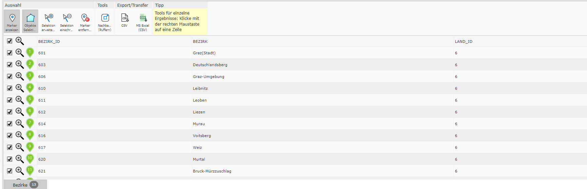
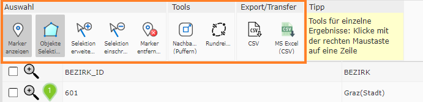
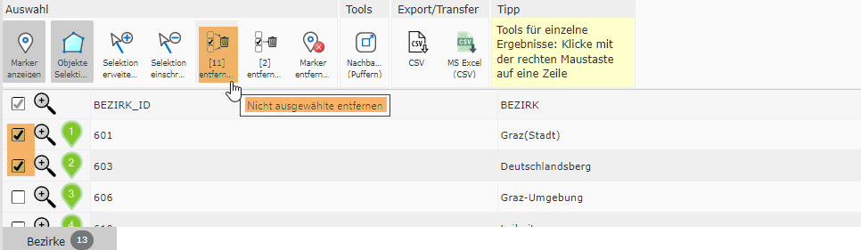

Ergebnisse im Desktop-Layout
============================

Die Ergebnis-Tabelle im Desktop-Layout unterscheidet sich geringfügig von der Tabelle im Mobile-Layout.

Detailergebnisse
----------------

Die Tabelle für Detailergebnisse wird gleich dargestellt, wie wenn man sich mehrere Ergebnisse als Tabelle anzeigen lässt. 

.. image:: img/tabelle_detailergebnisse.png

Ergebnisliste
-------------

Tabellen-Werkzeuge
------------------

In den Tabellen stehen folgende Tabellen-Werkzeuge zur Verfügung:

Die Funktionen der Tabellen-Werkzeuge sind ident mit denen im Mobile-Layout.

Selektiert man in einer Tabelle mit mehreren Ergebnissen Einträge, so kommen zwei Tabellen-Werkzeuge hinzu. Diese dazu dienen, entweder die nicht ausgewählten Ergebnisse zu entfernen oder das selektierte Ergebnis aus der Liste zu löschen.   

.. image:: img/ausgew_entfernen.png

.. _results-query-restriction:

Abfrageergebnis einschränken
~~~~~~~~~~~~~~~~~~~~~~~~~~~~

.. versionadded:: 9.26.4104

Liefert eine Abfrage oder ein Identify zu viele Ergebnisse, kann das Ergebnis über das Tabellen-Werkzeug **Einschränken** weiter eingeschränkt werden.
Dabei öffnet sich der :ref:`Query Builder <toc-querybuilder>`, in dem Bedingungen (**Feld**, **Operator**, **Wert**) für die Ergebnisse festgelegt werden.

Mit **Anwenden** wird die ursprüngliche Abfrage erneut ausgeführt. Berücksichtigt werden dabei die Abfragegeometrie (zB Identify-Punkt, Rechteck oder Puffer)
und die Eingaben der Detailsuche, ergänzt um die Bedingungen aus dem Query Builder. Die Tabelle zeigt danach nur noch die passenden Ergebnisse.

* Im Query Builder wird angezeigt, woher das Ergebnis stammt, zB aus einer Abfragegeometrie oder einer Detailsuche mit den eingegebenen Werten.
  Über **Anzeigen** wird die Abfragegeometrie kurz in der Karte dargestellt.
* Ist ein Ergebnis eingeschränkt, wird das in der Tabelle mit einem Hinweis angezeigt. Die Einschränkung kann über das **×** im Hinweis oder über
  **Einschränkung entfernen** im Query Builder wieder aufgehoben werden. Dabei wird die ursprüngliche Abfrage ohne Einschränkung erneut ausgeführt.
* Bei langsamen Diensten wird während der Abfrage ein Ladesymbol angezeigt; die Schaltflächen können in dieser Zeit nicht erneut geklickt werden.

.. note::
   Die Einschränkung wirkt nur auf das Abfrageergebnis in der Tabelle. Sie ist **kein Darstellungsfilter**, die Darstellung des Layers in der Karte bleibt unverändert.
   Das Werkzeug steht nur zur Verfügung, wenn für den Dienst der Query Builder erlaubt ist und Felder dafür freigegeben sind.

Tabellen-Tabs 
--------------

Ein weiterer Unterschied zum Mobile-Layout ist das Vorhandensein von Tabs. Je Abfragethema öffnet sich ein Tab. Rechts von der Tab-Bezeichnung steht die Anzahl der Ergebnisse. 

.. image:: img/ergebnis_tab.png

Fragt man ein Thema ein weiteres mal ab, wird der zuvor bereitgestellte Tab durch das aktualisierte Abfrageergebnis ersetzt. Wie man das Schließen von bereits geöffneten Tabellen durch Neuabfrage verhindert, wird im nächsten Unterkapitel beschrieben.

Ergebnisse Verlauf 
-------------------

Den klassischen Verlauf, wie beim Mobile-Layout, gibt es im Desktop-Layout nicht. Dafür ist es möglich, die Tabs anzupinnen. Hierfür muss auf das Stecknadelsymbol links von der Bezeichnung geklickt werden. 

.. image:: img/tab_anpinnen.png

Danach muss in das Bezeichnungsfeld eine individuelle Beschreibung eingetragen werden.

Durch das Anpinnen gehen diese Ergebnisse nicht verloren. Außerdem ist es möglich, dass beim *Karte teilen* die Tabelle ebenfalls mit geteilt wird. 
