Spezialwerkzeuge
================

Neben Linien, Flächen, Freihand, Texten, Rechtecken und Kreisen gibt es noch speziellere Graphiken auf die hier eingegangen wird.
Die meisten davon befinden sich in der Werkzeuggruppe *Messen* (siehe :ref:`Werkzeuggruppen <mapmarkup-tool-groups>`).

Für alle Messwerkzeuge gilt:

* Die genaue Klickabfolge wird beim gewählten Werkzeug im *Symbolik*-Fenster (gelb hinterlegt) beschrieben.
* Die Eigenschaften (Einheit, Winkel, Abstände, ...) können schon vor dem Zeichnen eingestellt werden. Die zuletzt
  gewählten Werte werden für weitere Elemente des gleichen Typs übernommen.
* Längen, Flächen und Winkel werden im Koordinatensystem der Karte berechnet (siehe Hinweis bei der
  :ref:`Bemaßungslinie <mapmarkup-measure-dimline>`).
* Die Elemente werden so gedruckt, wie sie in der Karte dargestellt werden, und können als Shape-Datei
  heruntergeladen werden. Die Messwerte (Längen, Winkel, Einheiten, ...) werden dabei als Attribute mitgeliefert.

Umgebungskreis
--------------

Mit diesem Werkzeug kann ein Kreis mit einem bestimmten Radius um einen Mittelpunkt definiert werden. Zum eigentlich Umgebungskreis werden noch Kreise mit Zwischenschritten angezeigt und beschriftet:

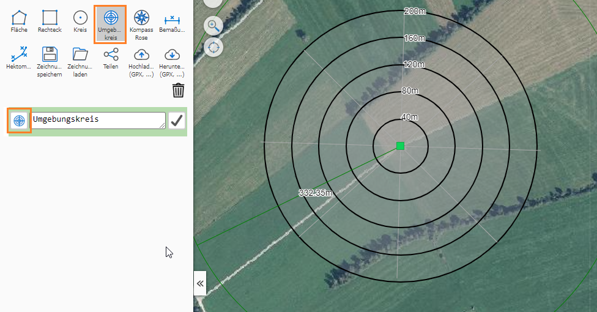

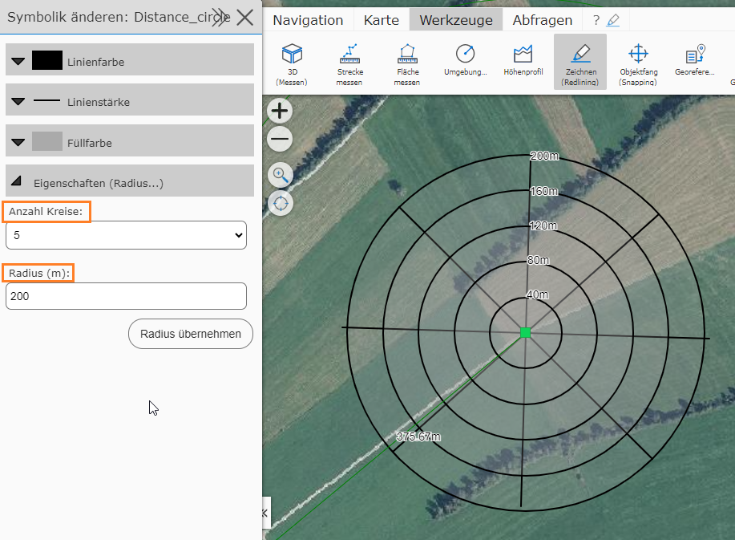

Das Ergebnis kann für Abstandsuntersuchungen verwendet werden.

.. _mapmarkup-measure-dimline:

Bemaßungslinie
--------------

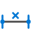

Mit diesem Werkzeug (*Bemaßung*) kann eine (Poly-) Linie gezeichnet werden, bei der jedes Segment mit der entsprechenden Länge in Metern beschriftet wird:

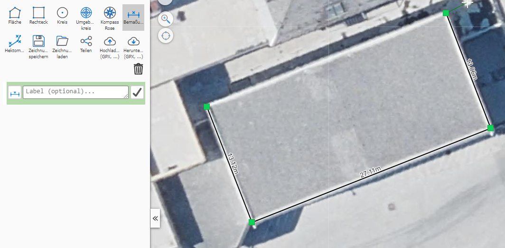

Optional werden auch Winkel beschriftet. Dazu in den Eigenschaften unter *Winkel anzeigen* die Einheit wählen
(*Keine*, *Grad*, *Gon* oder *Grad und Gon*). Unter *Winkelart* wird festgelegt, welcher Winkel angezeigt wird:

* **Innenwinkel:** der Winkel zwischen den beiden Segmenten an jedem Zwischenpunkt (0° bis 180°)
* **Ablenkwinkel (L/R):** die Richtungsänderung an jedem Zwischenpunkt, mit ``L`` (links) bzw. ``R`` (rechts);
  das ankommende Segment wird strichliert verlängert
* **Richtungswinkel (Azimut):** der Winkel jedes Segments von (Gitter-) Nord im Uhrzeigersinn (0° bis 360°);
  dazu wird eine strichlierte Nordlinie gezeichnet

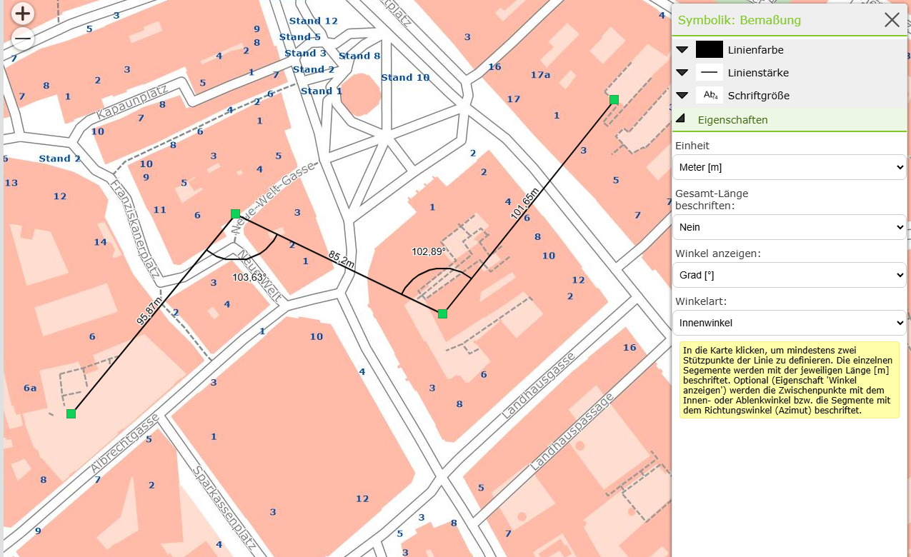

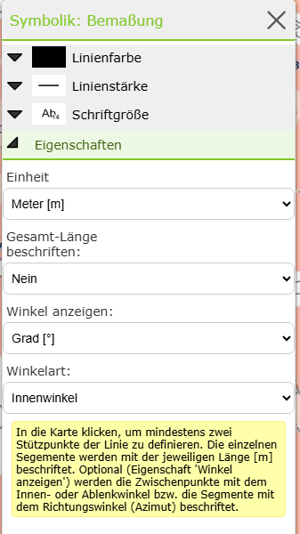

Bemaßungen aus bereits bestehenden Zeichnungen werden weiterhin ohne Winkel angezeigt.

.. note::
   Die angezeigte Länge wird immer *live* aus den Stützpunkte im aktuellen Karten Koordinatensystem berechnet. Übernimmt man die Zeichnung (durch Speichern und Laden) in eine Karte mit einem anderen Koordinatensystem, 
   könne die Werte abweichen. Dies gilt für allen für Karten, in denen mit *WebMercator* gerechnet wird, weil es hier große Verzerrungen geben kann. Welches Koordinatensystem verwendet wird kann im *Kartenviewer*
   links unten abgelesen werden.
   
   .. image:: img/advanced-tools3.png

.. _mapmarkup-measure-dimpolygon:

Bemaßungsfläche
---------------

Wie die Bemaßungslinie, nur für Flächen: jede Kante wird mit ihrer Länge, die Fläche mit ihrem Flächeninhalt beschriftet.
Auch hier können unter *Winkel anzeigen* die Innenwinkel an allen Ecken (0° bis 360°) in Grad, Gon oder beidem
beschriftet werden.

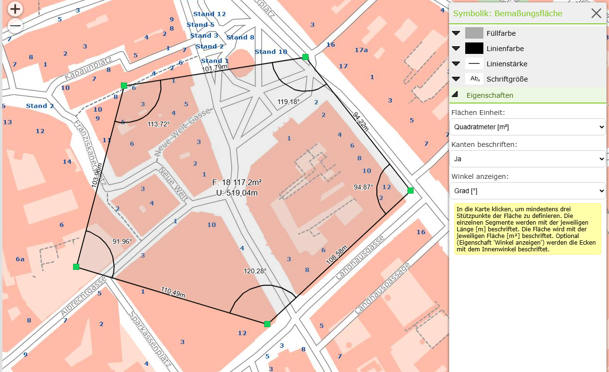

Hektometrierungslinie
---------------------

Bei dieser Linie werden Zwischenpunkte über einen vordefinierten Abstand (z.B. alle 100m) markiert und beschriftet:

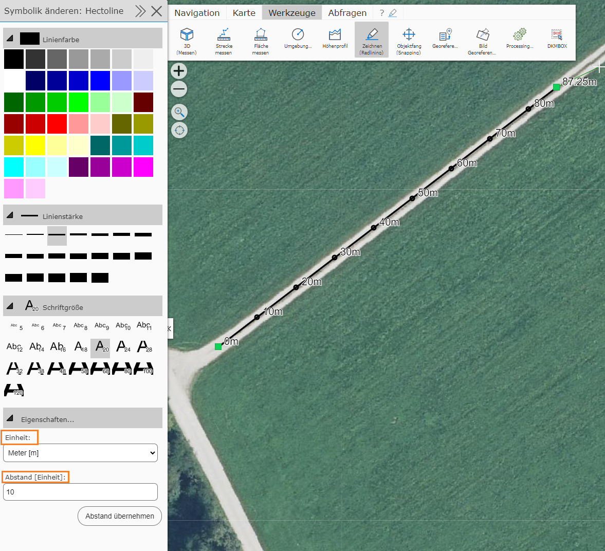

Als Anzeigeeinheit kann Meter [m] und Kilometer [km] angebeben werden.

.. note::
   Gleich wie bei der Bemaßungslinie werden auch hier die Abstandspunkte *live* berechnet und beziehen sich immer auf das aktuelle Kartenkoordinatensystem. Fügt man die Zeichnung in unterschiedliche Karten ein, kann es zu Abweichungen kommen!

.. _mapmarkup-measure-view-angle:

Sichtfeld (Winkel)
------------------

Zeichnet einen Sichtkegel mit einem vorgegebenen Öffnungswinkel, z. B. für den Blickwinkel einer Kamera oder eines Fensters.

* 1. Klick: Scheitelpunkt, 2. Klick: Richtung und Länge der Achse. Weitere Klicks verschieben nur noch das Achsenende.
* Eigenschaften: *Öffnungswinkel* (Standard 30°, mit *Winkel übernehmen* setzen), Einheit (Grad, Gon oder beides)
  und optional die Beschriftung der Achsenlänge.

Beschriftet werden der gesamte Öffnungswinkel und die beiden halben Winkel links und rechts der Achse.

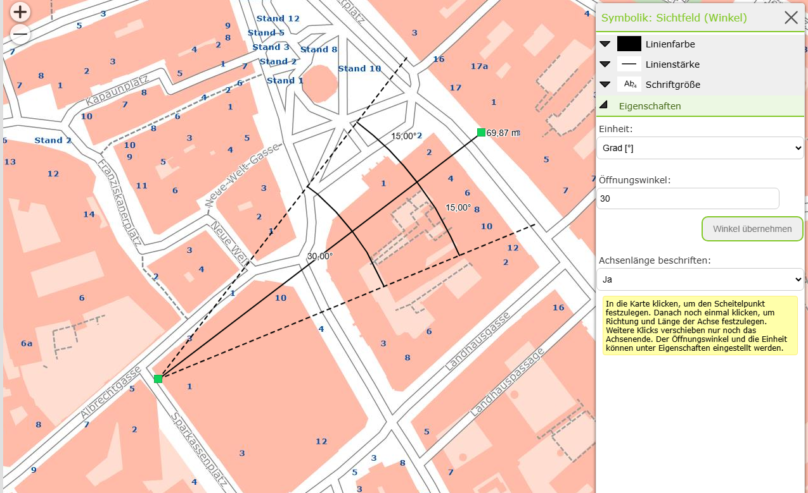

.. _mapmarkup-measure-intersection-angle:

Schnittwinkel
-------------

Misst den Winkel, unter dem sich zwei Linien schneiden, z. B. Straßenachsen oder Leitungen.

* Mit zwei Klicks die erste Linie und mit zwei weiteren Klicks die zweite Linie festlegen. Weitere Klicks verschieben
  nur noch den Endpunkt der zweiten Linie.
* Liegt der Schnittpunkt außerhalb der gezeichneten Linien, werden diese strichliert verlängert.
  Parallele Linien werden mit *parallel* beschriftet.
* Unter *Winkel anzeigen* wird festgelegt, welche Winkel beschriftet werden: Schnittwinkel, Nebenwinkel
  (180° minus Schnittwinkel), beide oder alle vier Winkel am Schnittpunkt. Die Einheit ist Grad, Gon oder beides.

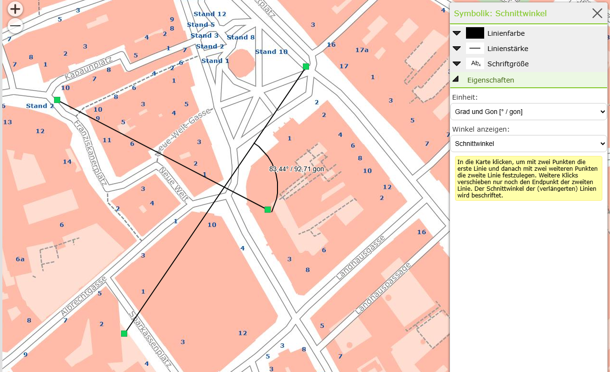

.. _mapmarkup-measure-circle-arc:

Kreisbogen
----------

Zeichnet einen Kreisbogen durch drei Punkte, z. B. um den Radius einer Kurve zu ermitteln.

* Anfangspunkt, einen beliebigen Punkt auf dem Bogen und Endpunkt anklicken. Weitere Klicks verschieben nur noch den Endpunkt.
  Liegen die drei Punkte auf einer Geraden, wird ein Hinweis angezeigt.
* Beschriftet werden Radius, Bogenlänge und Zentriwinkel. Unter *Beschriftung* kann gewählt werden, ob alle
  Werte oder nur einer davon angezeigt werden; die Winkeleinheit ist Grad, Gon oder beides.

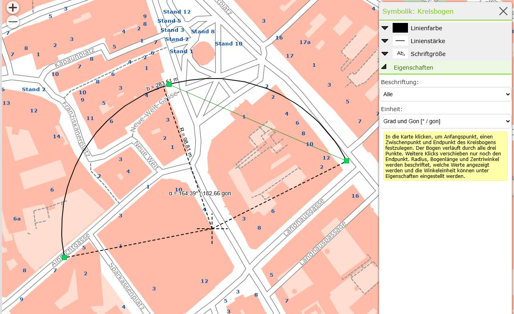

.. _mapmarkup-measure-perpendicular:

Normalabstand
-------------

Misst den Normalabstand (Lot) von beliebig vielen Punkten auf eine Bezugslinie, z. B. den Abstand von Objekten zu
einer Straßenachse, inklusive Stationierung.

* Zuerst die Bezugslinie zeichnen und mit einem Doppelklick auf den letzten Punkt abschließen (oder *Abschnitt schließen*
  im Kontextmenü bzw. Taste ``F``).
* Danach beliebig viele Punkte setzen: für jeden Punkt wird das Lot auf die Bezugslinie gezeichnet und mit dem
  Normalabstand beschriftet. Liegt der Lotfußpunkt außerhalb der Linie, wird die Linie strichliert verlängert.
* Eigenschaften: *Stationierung* des Lotfußpunktes in Metern (z. B. ``156,24m``), als Kilometrierung (z. B. ``0+156,24``)
  oder keine, sowie die *Längeneinheit* (m oder km).

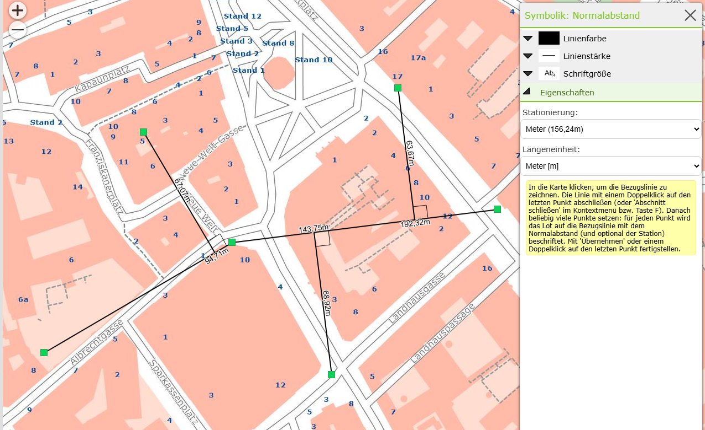

.. _mapmarkup-measure-buffer-zone:

Pufferzone
----------

Zeichnet eine Pufferzone mit einer bestimmten Breite um eine Geometrie, z. B. einen Schutzstreifen entlang einer Leitung.

* Unter *Quelltyp* wählen, um welche Geometrie gepuffert wird: Punkt, mehrere Punkte, Linie oder Fläche.
  Unter *Pufferbreite* die Breite in Metern eingeben und mit *Pufferbreite übernehmen* setzen.
* Danach die Quellgeometrie in die Karte zeichnen. Die Pufferzone wird vom Server berechnet und nach kurzer Zeit angezeigt.
* Beim Quelltyp *Punkt* verschiebt jeder weitere Klick den Punkt, bei *mehreren Punkten* fügt jeder Klick einen Punkt hinzu.
* Linien und Flächen können aus mehreren Teilen bestehen: mit *Abschnitt schließen* wird ein weiterer Teil
  (z. B. ein Loch in einer Fläche) begonnen.
* Bei Flächen ergibt eine negative Pufferbreite einen Puffer nach innen.
* Mit *Aus Objektgeometrie übernehmen* kann die Geometrie eines Objekts aus der Karte (Punkt, Linie oder Fläche,
  auch mehrteilig und mit Löchern) übernommen werden. Der Quelltyp wird dabei automatisch eingestellt.

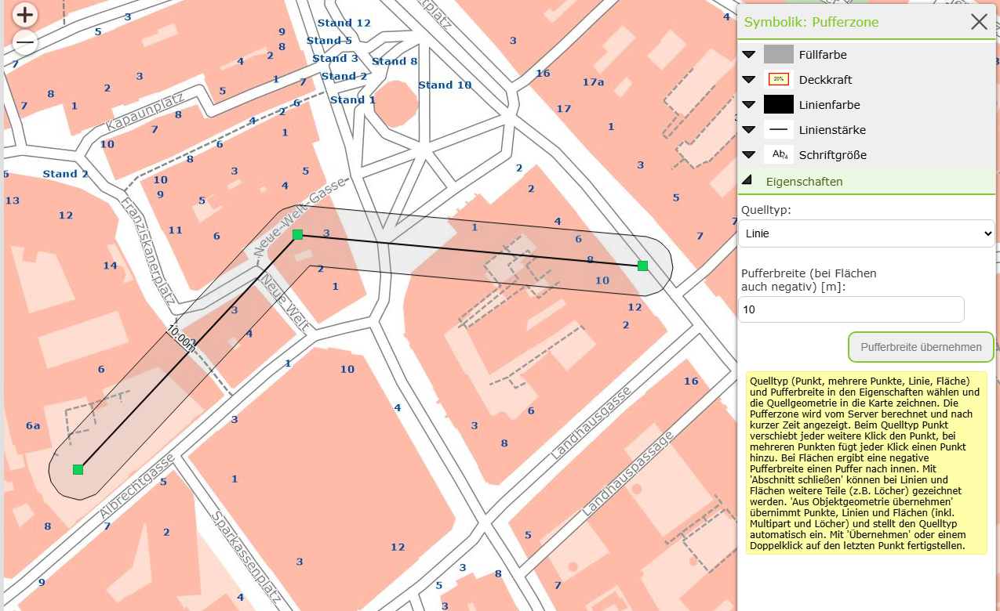

.. _mapmarkup-measure-object-distance:

Objektabstand
-------------

Misst die kürzeste Verbindung zwischen Objekten aus der Karte, z. B. vom Gebäude zur Grundstücksgrenze oder zwischen zwei Leitungen.

* Auf ein Objekt eines sichtbaren Layers klicken, um das Ausgangsobjekt (A) zu wählen.
* Danach auf beliebig viele weitere Objekte (B) klicken: für jedes Objekt wird die kürzeste Verbindung zu A wie eine
  Bemaßungslinie gezeichnet und mit der Länge beschriftet. Ein erneuter Klick auf ein Objekt B entfernt dessen Linie wieder.
* Liegen an der Klickposition mehrere Objekte, wird eine Auswahlliste (*Objekt wählen*) angezeigt. Fährt man mit der Maus
  über einen Eintrag, wird das Objekt in der Karte hervorgehoben.
* Bei Flächen wird der Abstand zum Rand gemessen. Berühren oder schneiden sich die Objekte, ist der Abstand 0
  (es wird keine Linie gezeichnet).
* Eigenschaften: *Längeneinheit* (m oder km) und optional eine Nummerierung der Verbindungen (*Nummer anzeigen*).

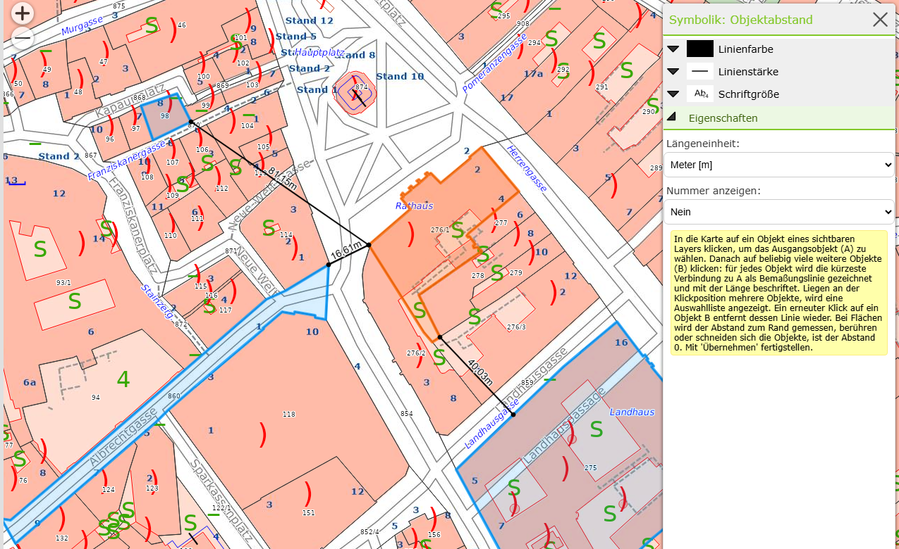

.. note::
   Die Abstände werden beim Zeichnen berechnet und mit der Zeichnung gespeichert. Ändern sich die Objekte in der Karte
   später, werden die gespeicherten Abstände nicht neu berechnet.

.. _mapmarkup-measure-grid:

Messgitter
----------

Zeichnet ein Gitter mit fester Maschenweite und beschrifteten Feldern (``A1``, ``B1``, ...), z. B. für Raster-Begehungen
oder um Positionen in einem Ausdruck zu referenzieren.

* Mit den ersten beiden Klicks die Grundkante des Gitters festlegen (Feld A1 beginnt beim ersten Punkt), mit dem dritten
  Klick die Tiefe. Das Gitter kann damit beliebig gedreht sein. Weitere Klicks verschieben nur noch den letzten Punkt.
* *Maschenweite X/Y* in Metern eingeben (Y leer = wie X) und mit *Maschenweite übernehmen* setzen (Standard 10 m).
* Mit *Am Koordinatenraster ausrichten* genügen zwei Klicks (gegenüberliegende Ecken). Das Gitter ist dann achsparallel und
  die Gitterlinien liegen auf runden Koordinatenwerten. Optional kann der *Ursprung* (Ecke von Feld A1) auf exakte
  Koordinaten gesetzt werden (*Ursprung übernehmen*).
* *Beschriftung*: Felder (``A1``, ``B1``, ...), Rand (Spalten/Zeilen), Koordinaten (nur bei ausgerichtetem Gitter) oder keine.
* Ein Gitter kann maximal 2500 Felder haben. Bei größeren Gittern wird nur der Rahmen mit einem Hinweis angezeigt.

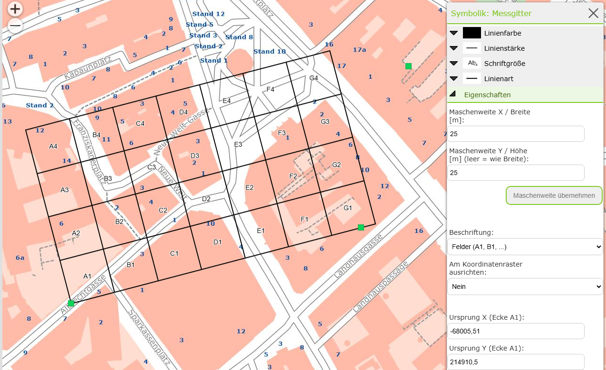

Kompass
-------

Neu hinzugekommen zum Map-Markup ist das Spezialwerkzeug *Kompass*.

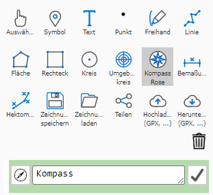

Fügt man einen solchen ein, hat man unter *Symbolik bearbeiten* die Möglichkeit, Farbe, Linienstärke und Anzahl der Winkel dementsprechend anzupassen.  

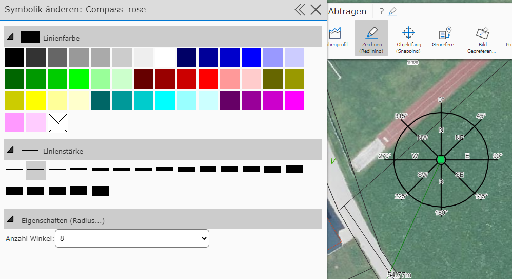

