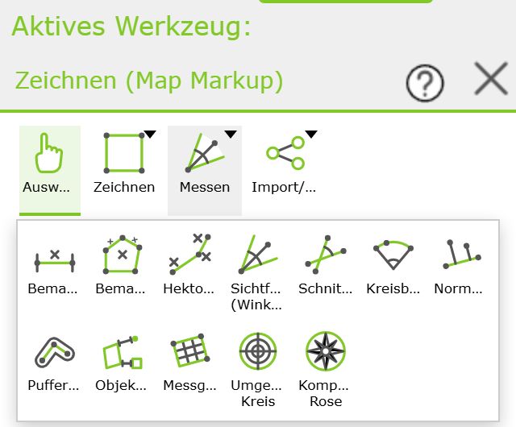
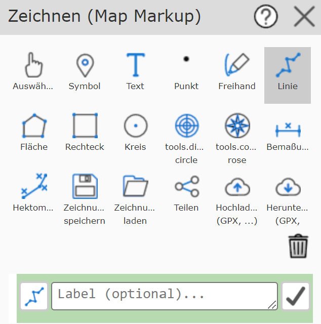
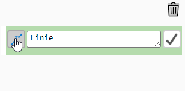
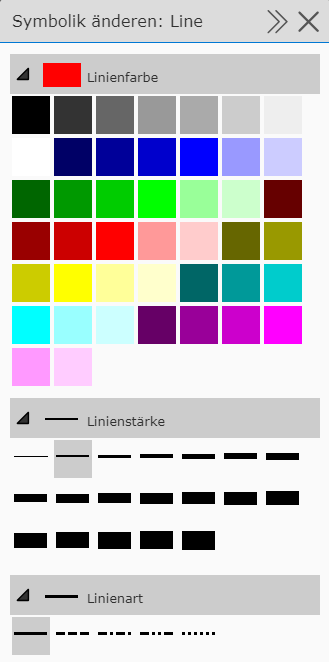
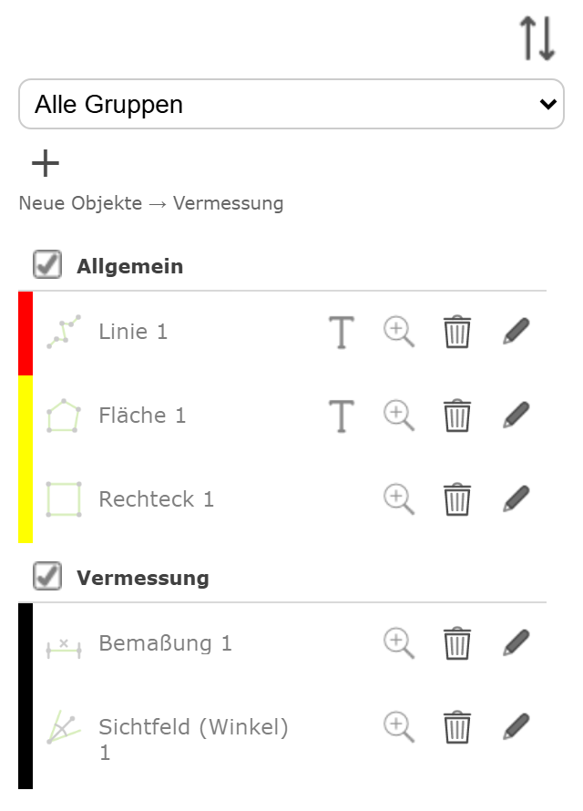
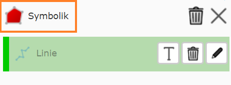

Bedienung Werkzeug Zeichnen (Map-Markup)
========================================

Allgemeine Bedienung
--------------------

Das Zeichnen (Map-Markup) Werkzeug ist eigentlich eine Sammlung von (Sub-) Werkzeugen, die es ermöglichen,
den Inhalt der Karte graphisch zu ergänzen.
Nach dem Öffnen des Werkzeugs wird der Zeichnen- (Map-Markup) Dialog angezeigt.
Darin werden alle Möglichen Zeichenwerkzeuge angeboten. 
Zusätzlich gibt es noch Buttons zum Verwalten von Zeichnungen (Laden, Speichern, Teilen, Upload, Download).

Die Buttons können je nach Endgerät variieren. In der Abbildung sind alle Werkzeuge zu sehen (Desktop).
Unter den Buttons wird noch einmal der Name des gerade aktiven Zeichenwerkzeugs angezeigt, sowie *gelb* hinterlegt eine
Beschreibung, wie dieses Werkzeug bedient wird (z.B. in die Karte klicken, auf bestehendes Zeichnungselement klicken, usw.).

Aufgrund dieser Beschreibung wird hier nicht auf die genaue Klickabfolge für die einzelnen Zeichenwerkzeuge eingegangen,
sondern es werden die Möglichkeiten und Unterschiede der Werkzeuge aufgezeigt.

.. _mapmarkup-tool-groups:

Werkzeuggruppen
^^^^^^^^^^^^^^^

Um Platz zu sparen, sind die Werkzeuge in Gruppen zusammengefasst:

* **Auswählen:** wird direkt angezeigt

* **Zeichnen:** Symbol, Text, Punkt, Freihand, Linie, Fläche, Rechteck, Kreis

* **Messen:** Bemaßung, Bemaßungsfläche, Hektometrierungslinie, Sichtfeld (Winkel), Schnittwinkel, Kreisbogen,
  Normalabstand, Pufferzone, Objektabstand, Messgitter, Umgebungskreis, Kompass Rose
  (siehe :doc:`Spezialwerkzeuge <advanced-tools>`)

* **Import/Export:** Zeichnung speichern/laden, Teilen, Hochladen, Herunterladen

Ein Klick auf eine Gruppe (erkennbar am kleinen Pfeil rechts oben) öffnet eine Auswahl mit den Werkzeugen der Gruppe.
Nach der Auswahl eines Werkzeugs schließt sich diese wieder (ebenso mit einem Klick daneben oder der ``Esc`` Taste).
Die Gruppe zeigt danach das Symbol des zuletzt gewählten Werkzeugs und ist hervorgehoben, solange eines ihrer Werkzeuge aktiv ist.
Werkzeuge, die auf einem Endgerät nicht verfügbar sind, werden auch in den Gruppen nicht angezeigt.

Neues Element zeichnen
----------------------

Legt man ein neues Element an (beispielsweise eine Linie), müssen durch Klicken in die Karte mindestens zwei Stützpunkte
definiert werden. Wir die Linie als gültig erkannt (mindesten zwei Stützpunkte), kann sie in die Karte *übernommen* werden.
Bis zum *Übernehmen* wird immer noch die Entwurfsskizze (Sketch) mit den Stützpunkten angezeigt. Solange die Entwurfsskizze angezeigt
wird, kann die Linie auch noch verändert werden:

* Weitere Stützpunkte zeichnen

* Stützpunkte mit der Maus verschieben

* Arbeitsschritte über das Entwurfs-Kontextmenü (rechte Maustaste) rückgängig machen

* über die Darstellungsoptionen die Darstellung ändern

Dass ein gezeichnetes Element *gültig* ist und in die Karte übernommen werden kann, ist über den Werkzeugdialog 
ersichtlich. Sobald bei einer Linie beispielsweise zwei Stützpunkte gesetzt wurden, erscheint im Werkzeugdialog 
folgender Button:

In die Karte übernommen wird das Zeichenelement mit dem Button mit Häkchen-Symbol. Nach dem Übernehmen kann gleich eine weitere Linie gezeichnet werden.
Bevor man ein Zeichenelement in die Karte übernimmt, kann optional noch eine Beschreibung angegeben werden.
Wenn die Linie beispielsweise einen Weg beschreibt, könnte man hier ``Wegbeschreibung nach ...`` eintragen.
Beschreibungen für Zeichenelemente sind optional, helfen allerdings das Element später wieder zuzuordnen und zu interpretieren.

**Tipp:** Es gibt noch weitere Möglichkeiten, um ein Zeichenelement in die Karte zu übernehmen und ein weiteres zu 
zeichnen:

* Abschließen eines Entwurfes mit einem Doppelklick. Danach kann gleich mit dem Zeichnen eines Elementes gleichen Types fortgesetzt werden.

* Ändern des Zeichenwerkzeugs: Zeichnet man eine Linie und möchte danach beispielsweise mit dem Zeichnen einer Fläche fortfahren, reicht es, auf das *Fläche* Werkzeug zu klicken. Eine gültige Linie wird dann automatich übernommen.

* Beschriften eines Zeichenelements: Im oben gezeigten *Übernehmen* Dialog wird rechts neben dem Eingebefeld ein *T* (für Text) angezeigt. Damit wechselt man zum Text Werkzeug und kann das aktuelle Element beschriften (zB Länge einer Linie - siehe unten)

Bereits übernommene Zeichenelemente werden zusätzlich zur Karte auch als Liste im Werkzeugdialog angezeigt
(siehe :ref:`Elementliste <mapmarkup-graphics-list>`).

Symbolik ändern
^^^^^^^^^^^^^^^

Um die Symbolik des jeweiligen Objektes zu ändern, ist links von der Beschreibung ein Symbol (je nach Objekt ist dieses ein anderes Symbol).

Klickt man dieses an, gelangt man in das Menü, um Änderungen an der Symbolik zu treffen. 
Wählt man beispielsweise das Linien-Werkzeug aus, gibt es folgende Darstellungsoptionen:

Im Regelfall sind die Optionsmenüs für Farbe, Linienstärke und Linienart bereits aufgeklappt. Möchte man zum Beispiel die Farbe einer Linie ändern, so muss diese nur ausgewählt werden. 
Gleiches gilt für Linienstärke und Linienart (durchgezogen, strichliert, ...).

Diese Optionen beziehen sich immer auf das gerade aktive Element. Ändert man eine Darstellungsoption, ändert sich die Darstellung
sofort in der Karte.

.. note:: 
   Zeichnet man ein neues Objekt, erkennt man die Änderungen erst, wenn man in die Karte klickt um Stützpunkte für das Element 
   zu erstellen.

.. _mapmarkup-symbology-panel:

Symbolik-Fenster (Desktop)
^^^^^^^^^^^^^^^^^^^^^^^^^^

Am Desktop wird die Symbolik in einem eigenen Fenster rechts neben der Karte angezeigt. Das Fenster
ist nicht modal: Werkzeugleiste und Elementliste bleiben sichtbar und es kann weitergezeichnet werden.

* Wählt man ein Zeichen- oder Messwerkzeug, öffnet sich das Fenster automatisch. Damit kann die Symbolik
  schon vor dem Zeichnen eingestellt werden; sie gilt dann für alle weiteren Elemente dieses Typs.
* Hinweise zum aktuellen Werkzeug (z. B. was als nächstes zu tun ist) werden ebenfalls in diesem Fenster angezeigt.
* Schließt man das Fenster (X), bleibt es geschlossen, bis das Zeichnen-Werkzeug erneut geöffnet wird.
  Über den Button *Symbolik: {Werkzeug}* im Werkzeugdialog kann es jederzeit wieder geöffnet werden.
* Werden in der Elementliste ein oder mehrere Elemente ausgewählt (mehrere mit gedrückter ``SHIFT`` Taste),
  zeigt das Fenster die Symbolik für die Auswahl (*Symbolik: Auswahl*). Ausgewählte Elemente werden auch in der
  Karte hervorgehoben. Wählt man ein anderes Zeichenwerkzeug, wird die Auswahl aufgehoben.

In der Elementliste werden Linien und Flächen mit einem farbigen Rand in der Farbe des Elements angezeigt,
Symbole mit dem jeweiligen Symbol. Änderungen der Symbolik werden sofort in der Liste übernommen.

Ob sich das Fenster automatisch öffnet, kann der Administrator in der ``custom.js`` festlegen.

.. _mapmarkup-graphics-list:

Elementliste
------------

Alle übernommenen Zeichenelemente werden im Werkzeugdialog unter den Werkzeug-Buttons als Liste angezeigt:

Jeder Eintrag zeigt:

* links einen farbigen Rand in der Farbe des Elements und ein Icon für den Typ (Linie, Fläche, Text, Bemaßung, ...)
* die Beschreibung des Elements bzw., wenn keine angegeben wurde, den Typ mit einer laufenden Nummer (z. B. *Linie 1*)
* je nach Typ einen *T Button* (Beschriften, siehe unten), eine *Lupe* (auf das Element zoomen),
  einen *Löschen Button* (Mistkübel) und einen *Bearbeiten Button* (Stift)

Fährt man mit der Maus über einen Eintrag, wird das Element in der Karte hervorgehoben. Bei zusammengesetzten
Messelementen wird dabei eine aussagekräftige Geometrie gezeigt (z. B. beim Normalabstand nur die Bezugslinie).

Mit dem Pfeil-Button oberhalb der Liste kann die Reihenfolge der Liste umgedreht werden.

Elemente auswählen
^^^^^^^^^^^^^^^^^^

Ein Klick auf einen Eintrag wählt das Element aus, ein weiterer Klick hebt die Auswahl wieder auf.

* Mit gedrückter ``STRG`` Taste werden einzelne Elemente zur Auswahl hinzugefügt oder daraus entfernt.
* Mit gedrückter ``SHIFT`` Taste werden alle Elemente zwischen dem angeklickten und dem nächsten bereits
  ausgewählten Element ausgewählt.

Ausgewählte Elemente werden in der Karte hervorgehoben. Für die Auswahl stehen oberhalb der Liste folgende Funktionen
zur Verfügung: Symbolik für alle ausgewählten Elemente ändern (*Symbolik: Auswahl*, siehe oben), Auswahl aufheben,
ausgewählte Elemente löschen und ausgewählte Elemente *In Gruppe verschieben…* (siehe unten).

Gruppen
^^^^^^^

Zeichenelemente können in Gruppen organisiert werden, z. B. um Vermessungsergebnisse von Anmerkungen zu trennen.
Jedes Element gehört genau zu einer Gruppe; ohne weitere Gruppen liegen alle Elemente in der Gruppe *Allgemein*.

* **Gruppe anlegen:** Über den Plus-Button neben der Auswahlliste eine neue Gruppe anlegen und einen Namen eingeben.
  Die neue Gruppe wird gleich zur aktiven Gruppe.
* **Aktive Gruppe:** Neu gezeichnete Elemente (auch Elemente, die aus einer Selektion übernommen werden) landen
  in der aktiven Gruppe. Bei der Anzeige *Alle Gruppen* steht unter der Auswahlliste, in welche Gruppe neue Elemente
  gezeichnet werden (z. B. *Neue Objekte → Vermessung*).
* **Gruppen anzeigen:** Über die Auswahlliste kann die Liste auf eine Gruppe eingeschränkt werden (*Alle Gruppen*
  zeigt alle Elemente, gegliedert nach Gruppen). Ist eine einzelne Gruppe gewählt, kann sie über die Buttons neben der
  Auswahlliste umbenannt oder gelöscht werden. Enthält eine zu löschende Gruppe Elemente, kann man wählen, ob diese
  in die Gruppe *Allgemein* verschoben oder mitgelöscht werden. Die Gruppe *Allgemein* kann nicht gelöscht werden.
* **Elemente verschieben:** Elemente in der Liste auswählen und über die Auswahlliste *In Gruppe verschieben…*
  die Zielgruppe wählen.
* **Ein-/Ausblenden:** Über das Häkchen bei der Gruppenüberschrift (bzw. neben der Auswahlliste) wird eine Gruppe
  in der Karte aus- oder eingeblendet. Ausgeblendete Gruppen werden in der Auswahlliste mit *ausgeblendet*
  gekennzeichnet und **nicht gedruckt**. Zeichnet man in eine ausgeblendete Gruppe, wird sie automatisch wieder eingeblendet.

Die Gruppen (inklusive Sichtbarkeit) werden beim Speichern einer Zeichnung mitgespeichert und beim Laden wiederhergestellt.

Liste filtern
^^^^^^^^^^^^^

Enthält die Liste viele Elemente, wird oberhalb ein Filterfeld (*Filtern…*) angezeigt. Damit werden nur noch
Einträge angezeigt, deren Beschreibung oder Typ den eingegebenen Text enthält. Mit *Treffer auswählen* werden alle
gefilterten Elemente ausgewählt (z. B. um ihre Symbolik gemeinsam zu ändern oder sie in eine Gruppe zu verschieben),
mit *Filter löschen* wird der Filter wieder entfernt.

Ab wie vielen Elementen das Filterfeld angezeigt wird, kann der Administrator in der ``custom.js`` festlegen.

Unterschiedliches Verhalten von Elementtypen
--------------------------------------------

Das oben beschriebene Verhalten ist nicht bei allen Elementtypen gleich. Hier ein paar Unterschiede/Besonderheiten:

**Symbol:** Symbole benötigen nur einen Stützpunkt. Nach dem Setzen des Punktes muss nicht zwingend auf den
*Übernehmen / Weiteres zeichnen* Button geklickt werden, sondern es reicht hier, noch einmal in die Karte zu klicken, 
um ein weiteres Symbol zu zeichnen. Dadurch ist ein schnelles Zeichnen von mehreren Symbolen durch einfaches Klicken
in die Karte (pro Klick wird ein Symbol in die Karte gesetzt) möglich.

**Freihand:** Mit diesem Werkzeug kann mit gedrückter Maustaste eine "freihand" Linie gezeichnet werden. Wird die 
Maustaste losgelassen, wird diese sofort in die Karte übernommen. Dadurch können sehr schnell und komfortabel mehrere
Freihandlinien gezeichnet werden.

**Text:** Um einen Text in der Karte zu setzen, ist nach dem Auswählen des Text Werkzeugs in die Karte zu klicken,
um die Position des Textes festzulegen. Dadurch wird die Position des Textes *gültig* und es kann der eigentliche 
Text über das Textfeld und über *Übernehmen / Weiteres zeichnen* geändert werden. Eine Änderung sollte gleich in der 
Karte ersichtlich werden. Sollte die Position noch einmal geändert werden, kann diese mit einem weiteren Klick 
in die Karte (oder Ziehen des Einfügepunktes) erfolgen. Mit klick auf das Häkchen wird der Text endgültig 
in die Karte übernommen.

.. _mapmarkup-text-rotation:

**Text drehen:**

Solange ein Text bearbeitet wird, erscheint rechts neben dem Ende der ersten Textzeile ein Drehen-Symbol.
Zieht man dieses mit der Maus, wird der Text um den Einfügepunkt gedreht (im Uhrzeigersinn, bezogen auf die Karte).
Mit gedrückter ``SHIFT`` Taste wird in 5°-Schritten, mit gedrückter ``STRG`` Taste in 15°-Schritten gedreht.
In der Nähe von 0°, 90°, 180° und 270° rastet der Text automatisch ein.

Alternativ kann der Winkel in der Symbolik unter *Drehung (°)* eingegeben und mit *Drehung übernehmen*
gesetzt werden; der Button *0°* stellt den Text wieder waagrecht. Das funktioniert auch für mehrere
ausgewählte Texte (*Symbolik: Auswahl*). Jeder neue Text beginnt waagrecht (0°).

Die Drehung wird beim Speichern, Drucken und beim Herunterladen als Shape-Datei (Attribut ``ROTATION``) übernommen.

Bestehendes Element verändern
-----------------------------

Es gibt zwei Möglichkeiten, um ein bereits gezeichnetes Element zu verändern.

* Über das Zeichenwerkzeug *Auswählen* (Finger): Damit wird über einen Klick auf das Objekt in der Karte das Element markiert und kann verändert werden.

* Über die Liste der bereits bestehenden Elemente: Durch Klicken auf ein Element in der Liste wird dieses für die Bearbeitung markiert. Mit dem Stift-Symbol kann das Objekt dann editiert werden.

Die zweite Methode ist praktisch, wenn mehrere Elemente übereinader liegen und ein geographisches Auswählen schwierig/unmöglich ist.

**Tipp:** Die Elemente in der Liste können leichter zugeordnet werden, wenn sie vor dem Übernehmen beschrieben wurden,
da die Beschreibung in der Liste angezeigt wird.

Wurde ein Element zum Ändern markiert, wird für das Element in der Karte der Entwurfs-*Sketch* angezeigt. Außerdem erscheint ein neues Symbol
*Symbolik* oberhalb der Auflistung, über das man in das Menü zum Bearbeiten der Darstellung kommt. 

Durch den Entwurfs-*Sketch* lässt sich die Geometrie des Elements verändern. Ebenfalls kann die Darstellung über die
Darstellungsoptionen angepasst werden. Zum Abschließen der Änderungen muss mit dem Häkchen-Button bestätigt werden, um diese zu übernehmen.

Bestehendes Element löschen
---------------------------

Zum Löschen eines Elements gibt es zwei Möglichkeiten:

* Element über das *Auswählen* (Finger) Werkzeug markieren und auf den *Löschen Button* (Mistkübel) rechts neben dem Beschreibungs Eingabefeld klicken.

* In der Liste mit den bestehenden Elementen auf das *Löschen Symbol* (Mistkübel) klicken.

Der Vorteil bei der ersten Methode ist, dass zuerst erkennbar ist, welches Element wirklich gelöscht wird.
Sind die Element nicht *beschrieben* worden, kann es beim Löschen aus der Liste zum Löschen des falschen Elementes kommen,
weil der angezeigte Text nicht eindeutig ist.

.. note::
   Ein Löschen ist endgültig. Beim Zeichnen (Map-Markup) Werkzeug wird kein **Undo** angeboten!

Elemente Beschriften
--------------------

Einige Elementtypen bieten eine Beschriftung nach bestimmten Eigenschaften an:

* **Linien:** Beschriften der Länge [m / km] der Linie

* **Flächen:** Beschriften des Flächeninhaltes [m² / km²]

Dabei erfolgt die Beschriftung halbautomatisch. Automatisch ermittelt wird nur der Textwert, die Positionierung des Textes
in der Karte erfolgt vom Anwender.

Die Vorgehensweise beim Beschriften ist folgende:

* Im Werkzeugdialog auf das *T Symbol* (Text) für das entsprechende Objekt klicken. 

Beim aktuellen Element befindet sich der Button rechts neben dem Textfeld für die optionale Beschreibung es Elements.
Bereits in die Karte übernommene Element weisen dieses Symbol in der Liste der erstellten Elemente auf.

* In die Karte klicken, um den Punkte zu positionieren.

* Eventuell Darstellung (Schriftgröße) ändern oder den Text erweitern/verändern.

* Auf *Übernehmen / Weiteres zeichnen* klicken, um den Text in die Karte zu übernehmen.