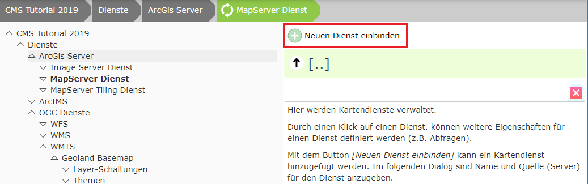
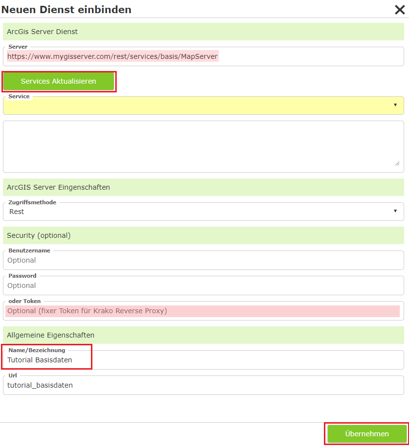

ArcGIS Server Dienst einbinden
==============================

Dazu im CMS-Baum auf ``Dienste/ArcGIS Server/MapServer Dienst`` wechseln:

Auf ``Neuen Dienst einbinden`` klicken:

Danach auf ``Services Aktualisieren`` klicken, einen Namen vergeben und auf ``Übernehmen`` klicken.

.. note::
   Wird der Name im Falle von AGS in der MXD gepflegt, wird auch dieser schon automatisch übernommen. Wird
   dieser nicht gepflegt, steht als Name im Dienst "Layer" oder "Layers" => wird nicht ins CMS übernommen => zu "Allgemein".

Das Übernehmen kann einige Sekunden dauern. Danach kann man in der Ansicht auf den Dienst klicken und so noch weitere Eigenschaften des Dienstes bearbeiten:

.. image:: img/image123.png

Erscheint der Dienst in der Liste, können weitere Eigenschaften des Dienstes bearbeitet werden:

.. image:: img/image124.png

* **Export Map Format:**
  Im Normalfall liefert der AGS das Ergebnis eines Kartenrequests im JSON-Format zurück. Darin steht dann die URL 
  zum eigentlichen Bild im Output-Verzeichnis. In unserem Fall wird das Bild im Output-Verzeichnis hinter unserer 
  Firewall abgelegt und ist NICHT über das Internet erreichbar. Das Kartenbild würde somit zwar erstellt werden, 
  ist aber für den Browser nicht erreichbar. Abhilfe für dieses Problem schafft der Wert „Image“. Dabei kommt das 
  Ergebnis vom AGS nicht als JSON, sondern als Bild (Bytes). Dieses nimmt WebGIS direkt in Empfang und legt es ins 
  „Cloud“-Output-Verzeichnis ab, das über das Internet verfügbar ist. Diese Methode hat in der Cloud auch den Vorteil, 
  dass über das Internet nicht nachvollzogen werden kann, woher der Kartendienst kommt.  
  Client (Browser) <-> WebGIS <-> ArcGIS Server

.. note::
   Für eine beim Kunden installierte WebGIS-Instanz sollte dieser Wert in der Regel leer bzw. auf JSON gestellt werden, 
   weil ein Client meistens Zugriff auf das Output-Verzeichnis hat. So folgt in der Regel weniger Traffic:
   
   1. Client (Browser) <-> WebGIS <-> ArcGIS Server (ImageRequest/JSON)
   2. Client (Browser)            <->           Output-Verzeichnis

Dynamische Dienste
------------------

Eine Vereinfachung bei der Parametrierung bieten folgende Einstellungen:

.. image:: img/add_ags_service1.png

In der Regel müssen im CMS für einen Dienst sowohl Darstellungsvarianten als auch Abfragen extra parametriert werden. 
Dadurch ist man als Administrator flexibel und kann bestimmen, welche Themen in welcher Art sichtbar geschaltet bzw. 
abgefragt werden können. Oft ist jedoch schon im Dienst eine Gruppierung der Themen definiert. Um nicht an mehreren 
Stellen dasselbe zu parametrieren, kann diese Einstellung herangezogen werden. Damit werden die Darstellungsvarianten 
*dynamisch* aus dem Dienst erstellt.

.. note::
   Unterhalb des Dienstes gibt es die Bereiche ``Abfragen`` und ``Layerschaltungen``, wo diese Eigenschaften individuell 
   parametriert werden können. Stellt man in den hier gezeigten Optionen einen anderen Wert als ``None`` ein, verschwinden 
   diese Bereiche. Es gibt nur die Möglichkeit, die Inhalte entweder *dynamisch* oder *individuell parametriert* zur Verfügung 
   zu stellen.

Dynamische Darstellungsvarianten
++++++++++++++++++++++++++++++++

* **None:** Die Darstellungsvarianten müssen individuell parametriert werden. Zuerst müssen dafür die einzelnen Schaltungen im Abschnitt ``Layerschaltungen`` des Dienstes definiert werden. Diese können dann im CMS-Knoten ``Karten Viewer`` in einen Darstellungs-Container hinzugefügt werden. Dieser Vorgang wird in den nächsten Abschnitten beschrieben.

* **Auto:** Der Themenbaum wird aus dem Dienst übernommen. Für jedes Thema wird in der entsprechenden Gruppe eine *Checkbox*-Schaltfläche angeboten. Im Karten Viewer wird im Darstellungsvarianten-TOC ein extra Container für diesen Dienst angelegt.

* **AutoMaxLevel(1,2,3):** Die Themen werden auch hier aus dem Dienst übernommen. Allerdings werden nicht alle Hierarchie-Ebenen übernommen. Die maximale Anzahl der Ebenen entspricht dem hier angeführten Wert. Themen, die in einer tieferen Ebene liegen, werden zu einem Thema (Gruppe) zusammengefasst, das über eine *Checkbox* geschaltet werden kann.

  Beispiel: es gibt folgende Themen in einem Dienst:

    * Basisdaten/Kataster/Grundstücke
    * Basisdaten/Kataster/Nutzungssymbole
    * Basisdaten/Kataster/Beschriftung

  Bei ``Auto`` wird der Baum folgendermaßen dargestellt:

  .. code::

        [[  Dienst Container ]]
        -----------------------
        + Basisdaten
          + Kataster
            [x] Grundstücke
            [x] Nutzungssymbole
            [x] Nutzungssymbole

  ``AutoMaxLevel2`` würde den Baum auf zwei Ebenen beschränken. Die unterste Gruppe würde als *Checkbox* erscheinen und alle darunter liegenden Themen schalten:

  .. code::

        [[  Dienst Container ]]
        -----------------------
        + Basisdaten
          [x] Kataster

  ``AutoMaxLevel1`` lässt schließlich nur noch eine Ebene innerhalb des Darstellungsvarianten-Containers zu:

  .. code::

        [[  Dienst Container ]]
        -----------------------
        [x] Basisdaten

.. note::
   Bei dynamischen Darstellungsvarianten erfolgt die Schaltung der einzelnen Layer immer über *Checkboxen*. Möchte man 
   weitere Möglichkeiten ausschöpfen (Buttons, Optionbox, Marker), muss der komplette Baum im CMS über 
   Layer-Schaltungen/Darstellungsvarianten parametriert werden.

Dynamische Abfragen
+++++++++++++++++++

* **None:** Die Abfragen müssen für den Dienst im Abschnitt ``Abfragen`` parametriert werden. Dieser Vorgang wird im nächsten Abschnitt beschrieben.

* **Auto:** Für jedes abfragbare Thema im Dienst wird zur Laufzeit ein Abfragethema erstellt. In der Tabelle der Ergebnisse werden alle Felder angezeigt.

.. note::
   Es werden alle abfragbaren Themen mit allen Feldern als Abfrage angeboten. Sollten bestimmte Themen als 
   Abfrage zur Verfügung stehen oder in Themen über Suchfelder gesucht werden können, müssen alle Abfragen 
   im CMS parametriert werden.

.. _cms-ags-user-renderer-labeling:

Benutzerdefinierte Darstellung und Beschriftung
-----------------------------------------------

.. versionadded:: 9.26.4104

Mit den folgenden Eigenschaften des Dienstes kann Anwendern erlaubt werden, die Darstellung bzw. die Beschriftung einzelner Layer
im Inhaltsverzeichnis des Karten Viewers selbst festzulegen (Menüpunkte **Darstellung** und **Beschriftung** im Kontextmenü, siehe
`Handbuch <https://docs.webgiscloud.com/de/webgis-manual/mapviewer/presentation/index.html#toc-context-menu>`_):

* **Benutzerdefinierte Darstellung erlauben (Darstellung aus TOC):** Der Anwender kann für einzelne Layer eine eigene Darstellung
  (Einheitliches Symbol, Eindeutige Werte, Klassen) festlegen.
* **Benutzerdefinierte Beschriftung erlauben (Beschriftung aus TOC):** Der Anwender kann für einzelne Layer eine eigene Beschriftung
  festlegen oder die Beschriftung ausschalten.

Beide Eigenschaften sind standardmäßig ausgeschaltet und können, wie andere berechtigbare Eigenschaften, auf bestimmte Rollen
eingeschränkt werden. Voraussetzungen:

* Der ArcGIS Server Dienst muss **DynamicLayers** unterstützen (``supportsDynamicLayers``). Die Funktion steht nur für Feature Layer
  (Punkt, Linie, Fläche) zur Verfügung.
* In der ``api.config`` muss die jeweilige Funktion in der Section ``toc-contextmenu`` freigeschaltet sein
  (``allow-toc-userrenderer`` bzw. ``allow-toc-userlabeling``, siehe :ref:`api-config-toc-contextmenu`).
* Zur Auswahl stehen dem Anwender nur die Felder, die auch im **QueryBuilder** angeboten werden.

Die vom Anwender festgelegte Darstellung bzw. Beschriftung wird bei jedem Kartenrequest über DynamicLayers an den ArcGIS Server
übergeben. Ungültige Definitionen (zB nicht erlaubte Felder) werden ignoriert; der Layer wird dann in der Standard-Darstellung gezeichnet.

.. _cms-ags-query-statistics:

Statistik zum Abfrageergebnis
-----------------------------

.. versionadded:: 9.26.4104

In der Ergebnistabelle des Karten Viewers steht das Werkzeug **Statistik** zur Verfügung (Anzahl, Minimum, Maximum, Mittelwert, Summe
und Anzahl je Wert eines Feldes, siehe
`Handbuch <https://docs.webgiscloud.com/de/webgis-manual/mapviewer/search_identify/operations/results_desktop/results_desktop.html#results-query-statistics>`_).
Die Statistik wird vom ArcGIS Server über die gesamte Abfrage berechnet (``outStatistics`` bzw. ``groupByFieldsForStatistics``), auch wenn
die Abfrage mehr Treffer liefert, als in der Tabelle angezeigt werden. Eine eigene Konfiguration ist nicht notwendig. Es gelten folgende
Voraussetzungen und Einschränkungen:

* Die Statistik steht nur für Layer von **ArcGIS Server** Diensten zur Verfügung, die Statistikabfragen unterstützen (``supportsStatistics``).
  Für andere Dienste (zB WMS, WFS) wird das Werkzeug nicht angezeigt.
* Für den Dienst muss der **QueryBuilder** erlaubt sein. Angeboten werden nur die Felder, die im CMS beim Dienst unter **QueryBuilder** freigegeben sind
  (wie beim Werkzeug *Einschränken*).
* Für Datumsfelder werden nur Kennzahlen (Anzahl, Minimum, Maximum) berechnet, eine Gruppierung bzw. Einschränkung über Werte ist nicht möglich.
* Die Anzahl der Werte bei *Anzahl je Wert* ist durch die maximale Anzahl an Datensätzen des Dienstes (``maxRecordCount``) begrenzt.
  Werden nicht alle Werte geliefert, wird das dem Anwender angezeigt.
* Eine Einschränkung über einen Platz (alle Werte mit gleicher Anzahl) ist auf 1000 Werte begrenzt und nicht möglich, wenn leere Werte oder
  Werte mit Komma enthalten sind.
