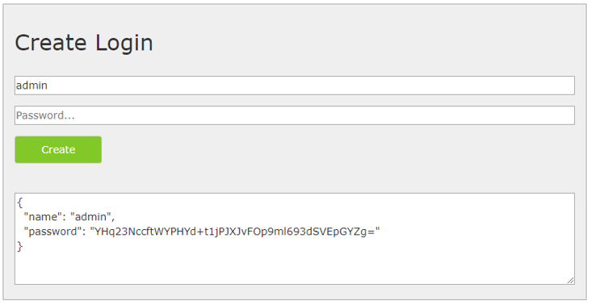

=================================
Konfiguration der CMS Applikation
=================================

Datei ``_config/cms.config``
============================

Die Konfiguration der CMS-Anwendung erfolgt über die Datei ``webgis-cms/_config/cms.config``.

Dabei handelt es sich um eine JSON-Datei (**JavaScript Object Notation**), ein strukturiertes Datenformat, das unabhängig von JavaScript ist. Beim Bearbeiten der Datei ist darauf zu achten, dass sie weiterhin gültiges JSON bleibt. Insbesondere dürfen keine Kommentare eingefügt und Schlüssel müssen als Strings in Anführungszeichen geschrieben werden.

.. note:: Hinweis zur JSON-Syntax

    - Attribute und Werte werden durch ``:`` getrennt, z. B.: ``"force-https": false``
    - Objekte (mit mehreren Attributen) werden in geschweifte Klammern gesetzt: ``{ … }``
    - Arrays werden durch eckige Klammern gekennzeichnet: ``[ … ]``. Die einzelnen Werte werden durch Kommas getrennt.
    - In einem Array können Objekte aufgelistet werden (z. B. ``cms-items``): ``[ { "object1": ... }, { "object2": ... } ]``
    - In einem Array können einzelne Werte (Strings, Zahlen) aufgelistet werden (z. B. ``http-get``): ``[ "url1", "url2" ]``
    - Ein Backslash ``\`` ist in einer Zeichenkette in JSON ein besonderes Zeichen. Um tatsächlich einen Backslash anzugeben, muss ein doppelter ``\\`` verwendet werden (z. B. in Pfaden). Andernfalls ist die Konfigurationsdatei kein gültiges JSON mehr!

Die Vorlage hat folgendes Format:

.. code-block:: json

    {
      "shared-crypto-keys-path": "C:\\apps\\webgis/local/webgis-repository/security/keys",
      "company": "",
      "force-https": false,
      "services-default-url-scheme": "http://",
      "webgis-portal-instance": "http://localhost:5002",
      "cms-display-url": "https://myserver.com/cms",
      "cms-items": [
        {
          "id": "webgis-release-default",
          "name": "WebGIS Release Default",
          "path": "C:\\apps\\webgis/local/webgis-repository/cms/param/webgis-release-default",
          "scheme": "webgis",
          "deployments": [
            {
              "name": "default",
              "target": "C:\\apps\\webgis/local/webgis-repository/cms/publish/cms-default.xml",
              "replacement-file": "",
              "postEvents": {
                "commands": [],
                "http-get": ["http://localhost:5001/cache/clear"]
              }
            }
          ]
        },
        {
          "id": "webgis-custom",
          "name": "WebGIS Custom",
          "path": "C:\\apps\\webgis/local/webgis-repository/cms/param/webgis-custom",
          "scheme": "webgis",
          "deployments": [
            {
              "name": "default",
              "target": "C:\\apps\\webgis/local/webgis-repository/cms/publish/cms-custom.xml",
              "replacement-file": "",
              "postEvents": {
                "commands": [],
                "http-get": ["http://localhost:5001/cache/clear"]
              }
            }
          ]
        }
      ]
    }

Im Folgenden findet sich eine Übersicht der wichtigsten Konfigurationsparameter.

Abschnitt ``Root-Element``
--------------------------

.. list-table::
   :widths: 20 80
   :header-rows: 1

   * - **Attribut**
     - **Beschreibung**
   * - ``webgis-portal-instance``
     - Die interne URL zum **WebGIS-Portal**. Dieser Parameter wird benötigt, wenn CMS-Knoten autorisiert werden sollen. Über diese URL ruft die CMS-Applikation die verfügbaren **Benutzer und Gruppen** ab (z. B. **AD-Benutzer/Gruppen**). Da diese Abfrage direkt von Server zu Server erfolgt, kann hier auch eine **interne URL** verwendet werden. Befinden sich beide Applikationen auf demselben Server, kann beispielsweise auch ``http://localhost/webgis-portal`` genutzt werden.
   * - ``cms-display-url`` *(optional)*
     - Dieser optionale Parameter ist hilfreich, wenn das CMS hinter einem **Reverse-Proxy-Server** betrieben wird und die Applikation nicht automatisch ermitteln kann, welche URL für den Anwender sichtbar ist. In diesem Fall kann hier die gewünschte **externe URL** angegeben werden.
   * - ``git-workspace-root`` *(optional)*
     - Standard-Verzeichnis für die Arbeitsbereiche aller CMS, die mit Git versioniert werden (siehe :ref:`cms-config-git`). Kann pro CMS mit ``git.workspace-root`` überschrieben werden.

       .. versionadded:: 9.26.4102
   * - ``mcp`` *(optional)*
     - Einstellungen für den MCP-Endpunkt für KI-Agenten (siehe :ref:`cms-config-mcp`).

       .. versionadded:: 9.26.4104
   * - ``elasticsearch-endpoint`` *(veraltet)*
     - Wird nicht mehr verwendet und kann aus bestehenden Konfigurationen entfernt werden. Die Knotensuche im CMS filtert immer lokal im geladenen Baum.

       .. deprecated:: 9.26.4104

Mit einem **Web-CMS** können mehrere Bäume verwaltet werden. Für jeden Baum wird ein Objekt im ``cms-items``-Array angelegt. Der Wert von ``cms-items`` muss ein **Array** sein, das einzelne ``cms-item``-Objekte enthält.

Ein ``cms-item``-Objekt besitzt verschiedene Attribute. Die beiden hervorgehobenen Werte (``path``, ``target``) geben beispielsweise an: 

- ``path``: Wo sich die Wurzel des CMS-Baums befindet.  
- ``target``: Wohin ein CMS veröffentlicht wird.

Abschnitt ``cms-item``
----------------------

.. list-table::
   :widths: 20 80
   :header-rows: 1

   * - **Attribut**
     - **Beschreibung**
   * - ``id``
     - Eine eindeutige ID für das CMS. Sie sollte nur aus Kleinbuchstaben und Zahlen bestehen (keine Umlaute).
   * - ``name``
     - Ein sprechender Name für das CMS.
   * - ``path``
     - Pfad zum Wurzelverzeichnis des CMS-Baums.
   * - ``scheme``
     - Muss immer auf ``webgis`` gesetzt werden.
   * - ``secrets-password`` *(optional)*
     - Wenn in diesem CMS auf Secrets zugegriffen werden soll, erscheint ein Passwortdialog. Hier kann das Passwort festgelegt werden, das für den Zugriff erforderlich ist. Dieser Wert kann auch weggelassen oder leer gelassen werden – der Dialog erscheint dann trotzdem im CMS, muss jedoch ohne Eingabe bestätigt werden.
   * - ``deployments``
     - Ein Array von Deployment-Objekten. Pro Baum können mehrere Deployments (1:n) angelegt werden. Das Ergebnis eines Deployments ist eine ``cms.xml``-Datei, die ins WebGIS eingebunden werden kann.

       **Beispiel für Deployments:**
       
       .. code-block:: json

           [
               {
                   "deployment": "Deployment 1"
               },
               {
                   "deployment": "Deployment 2"
               }
           ]

       Mehrere Deployments können hilfreich sein, um für Test-, Ausfall-, Schulungs- und Produktivsysteme unterschiedliche XML-Dateien zu erzeugen.
   * - ``git`` *(optional)*
     - Aktiviert die Versionierung dieses CMS mit Git (siehe :ref:`cms-config-git`). Fehlt dieser Abschnitt, funktioniert das CMS wie bisher.
   * - ``mcp`` *(optional)*
     - Überschreibt ``mcp.enabled`` aus dem Root-Element für dieses CMS und legt ``discovery-deployment`` fest (siehe :ref:`cms-config-mcp`).

       .. versionadded:: 9.26.4104

.. _cms-config-git:

Abschnitt ``git``
-----------------

.. versionadded:: 9.26.4102

Mit dem optionalen Abschnitt ``git`` in einem ``cms-item`` wird der CMS-Baum mit Git versioniert. Die Bedienung im CMS ist unter :ref:`cms-git` beschrieben.

.. code-block:: json

    {
      "git-workspace-root": "C:\\apps\\webgis/local/webgis-repository/cms/git-workspaces",
      "cms-items": [
        {
          "id": "webgis-custom",
          "name": "WebGIS Custom",
          "path": "C:\\apps\\webgis/local/webgis-repository/cms/param/webgis-custom",
          "scheme": "webgis",
          "git": {
            "remote-url": "https://git.mycompany.com/gis/webgis-custom-cms.git",
            "username": "webgis-cms",
            "token": "%WEBGIS_CMS_GIT_TOKEN%",
            "default-branch": "main",
            "committer-name": "WebGIS CMS",
            "committer-email": "webgis-cms@mycompany.com"
          },
          "deployments": []
        }
      ]
    }

.. list-table::
   :widths: 20 80
   :header-rows: 1

   * - **Attribut**
     - **Beschreibung**
   * - ``remote-url``
     - URL des Git-Repositorys (HTTPS), z. B. auf GitLab, Gitea, Azure DevOps oder GitHub. Das Repository muss bereits existieren, kann aber leer sein. Ist es leer, wird es beim ersten Arbeitsbereich mit dem CMS-Baum aus ``path`` befüllt. Danach wird ``path`` nicht mehr verwendet.
   * - ``username``
     - Benutzer eines technischen Accounts am Git-Server.
   * - ``token``
     - Zugriffstoken (z. B. *Personal Access Token*) des technischen Accounts mit Lese- und Schreibrechten auf das Repository. Umgebungsvariablen in der Form ``%NAME%`` werden ersetzt, damit das Token nicht im Klartext in der ``cms.config`` stehen muss.
   * - ``default-branch`` *(optional)*
     - Hauptzweig, der beim normalen Deploy veröffentlicht wird und in den Arbeitszweige übernommen werden. Standard: ``main``.
   * - ``workspace-root`` *(optional)*
     - Verzeichnis am CMS-Server für die Arbeitsbereiche der Bearbeiter, den Deploy-Klon und die Zwischenstände für den Fast Deploy. Standard: ``git-workspace-root`` aus dem Root-Element. Darunter wird pro CMS ein Ordner ``{cms-id}`` angelegt.
   * - ``author-email-domain`` *(optional)*
     - Als Autor eines Commits wird der angemeldete CMS-Benutzer eingetragen. Liefert die Anmeldung keine E-Mail-Adresse, wird ``{benutzer}@{author-email-domain}`` verwendet. Standard: ``cms.local``.
   * - ``committer-name``, ``committer-email`` *(optional)*
     - Committer aller Commits, z. B. der technische Account. Standard: der Autor.

Git ist nur aktiv, wenn ``remote-url`` und ein Verzeichnis für die Arbeitsbereiche (``workspace-root`` oder ``git-workspace-root``) angegeben sind. Fehlerhafte Einstellungen werden beim Start des CMS protokolliert. Das CMS läuft dann ohne Git.

.. danger::

    Versioniert wird der **gesamte** CMS-Baum, inklusive Berechtigungen und verschlüsselter Secrets. Das Repository muss **privat** sein und auf einem **vertrauenswürdigen** Git-Server liegen.

.. note::

    Git wird nur für CMS-Bäume im Dateisystem unterstützt (``cms-items`` mit ``path``).

.. _cms-config-mcp:

Abschnitt ``mcp``
-----------------

.. versionadded:: 9.26.4104

Mit dem optionalen Abschnitt ``mcp`` wird der MCP-Endpunkt für KI-Agenten aktiviert. Die Verwendung ist unter :ref:`cms-mcp` beschrieben. Der Abschnitt kann im Root-Element (gilt für alle CMS) und in einzelnen ``cms-items`` (``enabled``, ``discovery-deployment``) angegeben werden.

Zusätzlich muss MCP für das CMS in der Datei ``_config/mcp.config`` freigegeben sein (siehe :ref:`cms-config-mcp-config`). Dort wird auch festgelegt, welche Werkzeuge (Lesen, Schreiben, Deploy) angeboten werden.

.. code-block:: json

    {
      "mcp": {
        "enabled": false,
        "token-store-path": "C:\\apps\\webgis/local/webgis-repository/cms/mcp"
      },
      "cms-items": [
        {
          "id": "webgis-custom",
          "mcp": {
            "enabled": true,
            "discovery-deployment": "Test"
          }
        }
      ]
    }

.. list-table::
   :widths: 20 80
   :header-rows: 1

   * - **Attribut**
     - **Beschreibung**
   * - ``enabled``
     - Aktiviert den MCP-Endpunkt ``/{cms-id}/mcp`` und die Verwaltung der Zugriffstokens. Im Root-Element gilt der Wert für alle CMS, in einem ``cms-item`` überschreibt er diesen für das jeweilige CMS. Standard: ``false``.
   * - ``token-store-path`` *(optional, nur Root-Element)*
     - Verzeichnis am CMS-Server, in dem die Zugriffstokens aller CMS dieser Installation gespeichert werden (siehe :ref:`cms-config-mcp-token-store`). Standard: ``{git-workspace-root}/_mcp``, ist kein ``git-workspace-root`` angegeben, ``_mcp`` im Verzeichnis der CMS-Applikation.
   * - ``discovery-deployment`` *(optional, nur cms-item)*
     - Name des Deployments, dessen Umgebung verwendet wird, wenn das CMS für den Agenten Dienste abfragt (siehe :ref:`cms-config-mcp-discovery-deployment`). Standard: das erste Deployment des CMS.

.. note::

    Der MCP-Endpunkt funktioniert nur, wenn der Zugang zum CMS gesichert ist (``_config/application-security.config``). Ohne Anmeldung antwortet der Endpunkt mit ``403``.

.. _cms-config-mcp-token-store:

Token-Speicher (``token-store-path``)
~~~~~~~~~~~~~~~~~~~~~~~~~~~~~~~~~~~~~

Die Zugriffstokens, die Benutzer im CMS unter **KI-Agenten (MCP)** erstellen (siehe :ref:`cms-mcp`), werden in der Datei ``tokens.json`` in diesem Verzeichnis gespeichert. Eine Datei enthält die Tokens aller CMS der Installation.

- Pro Token werden Id, CMS-Id, Benutzer, Bezeichnung, Berechtigung, Erstell- und Ablaufdatum, letzte Verwendung sowie ein **SHA-256-Hash** des Tokens gespeichert. Der Token selbst wird **nicht** im Klartext gespeichert und kann aus der Datei nicht wiederhergestellt werden.
- Das Verzeichnis darf **nicht** innerhalb eines CMS-Baums oder eines Git-Repositories liegen, damit die Datei nicht deployt oder committet wird. Schreibrechte braucht nur der Benutzer, unter dem das CMS läuft.
- Der Pfad muss **pro CMS-Installation eindeutig** sein. Das CMS hält die Tokens im Speicher; teilen sich mehrere CMS-Installationen (z. B. hinter einem Load-Balancer) denselben Pfad, bemerken sie neue oder widerrufene Tokens der anderen Installation nicht.
- Geht die Datei verloren, werden alle Tokens ungültig und müssen von den Benutzern neu erstellt werden. Eine Sicherung der Datei ist daher nicht unbedingt nötig.

.. _cms-config-mcp-discovery-deployment:

Deployment für Dienst-Abfragen (``discovery-deployment``)
~~~~~~~~~~~~~~~~~~~~~~~~~~~~~~~~~~~~~~~~~~~~~~~~~~~~~~~~~

Einige Werkzeuge fragen für den Agenten den Dienst selbst ab, z. B. ``get_layer_fields``, das die Felder eines Layers direkt vom ArcGIS Server oder WFS liest. Im CMS stehen Dienst-URL und Zugangsdaten aber oft nicht im Klartext, sondern als **Secret-Platzhalter**, z. B.:

- ``{{secret-ags-server}}/rest/services/Kataster/MapServer`` als Dienst-URL, damit jedes Deployment (Test, Staging, Produktion) auf den passenden ArcGIS Server zeigt,
- ``{{secret-ags-user}}`` und ``{{secret-ags-password}}`` als Zugangsdaten.

Secrets können pro Deployment (Umgebung) unterschiedliche Werte haben (siehe :doc:`../../apps/cms/secrets/index`). Für eine Dienst-Abfrage muss das CMS daher wissen, mit den Werten **welches Deployments** die Platzhalter ersetzt werden. Das legt ``discovery-deployment`` fest:

- Die Platzhalter werden **am CMS-Server** ersetzt, wie beim Deploy. Die ersetzten Werte (Server-Adressen, Passwörter, ...) werden **nie** an den Agenten übergeben, auch nicht in Fehlermeldungen.
- Ist ``discovery-deployment`` nicht gesetzt oder unbekannt, wird das erste Deployment des CMS verwendet.
- Der Agent kann pro Aufruf ein anderes Deployment angeben (Parameter ``deployment``), z. B. mit dem Prompt *"Lies die Felder vom Produktions-Deployment"*.

**Empfehlung:** ein **Test- oder Staging-Deployment** angeben. Abfragen des Agenten belasten dann nicht die produktiven Dienste. In der Regel sind die Felder in allen Umgebungen gleich; Abweichungen fallen spätestens beim Testen über einen Branch-Deploy auf.

Abschnitt ``deployments``
-------------------------

.. list-table::
   :widths: 20 80
   :header-rows: 1

   * - **Attribut**
     - **Beschreibung**
   * - ``name``
     - Ein sprechender Name für das Deployment (z. B. *localhost*, *Entwicklung*, *Schulung*, *Test*, *Produktion*).
   * - ``target``
     - Der Pfad für die CMS-Datei. Das CMS erstellt im gleichen Ordner ein Verzeichnis ``_archive``, in dem bestehende XML-Dateien vor dem Überschreiben gesichert werden. Falls diese Sicherungen nicht mehr benötigt werden, kann der Ordner manuell gelöscht werden. Hier kann auch eine URL zur API angegeben werden, z. B.: ``https://localhost/api/cache/upload/{cms-name}``. ``{cms-name}`` entspricht dem CMS-Namen, wie er in der ``api.config`` definiert ist, z. B.:  
      
       .. code-block:: xml

           <add key="cmspath_my-cms" value="{path-to-cms.xml}" />

       Ergibt die URL: ``https://{webgis-api-url}/cache/upload/my-cms``

       Der Upload von CMS XML-Dateien hat den Vorteil, dass **WebGIS-CMS** keinen direkten Zugriff auf das Dateisystem der **WebGIS API**-Anwendung benötigt.

       .. danger::

           In diesem Fall müssen jedoch ein **Client** und ein **Secret** definiert werden, um sicherzustellen, dass der Upload nur von einer autorisierten CMS-Instanz durchgeführt wird.

   * - ``client`` und ``secret`` *(erforderlich, wenn ``target`` eine API-URL ist)*
     - Hier kann ein beliebiger *Client* und ein beliebiges *Secret* definiert werden. Das *Secret* sollte ein sicheres Passwort mit mindestens **32 Zeichen** sein. Damit die **WebGIS API** den Upload akzeptiert, muss in der ``api.config`` ein Abschnitt ``<section name='cms-upload-{cms-name}'>`` vorhanden sein, in dem derselbe *Client* und dasselbe *Secret* hinterlegt ist.
   * - ``replacement-file`` *(optional)*
     - Pfad zu einer **Ersatzdatei** (*Replacement File* aus einem alten CMS), die für dieses Deployment verwendet werden soll.
   * - ``ignoreAuthentification`` *(optional)*
     - Wenn dieser Wert auf ``true`` gesetzt ist, werden Berechtigungen im CMS ignoriert. Dies kann für **Schulungs- oder Testsysteme** nützlich sein, in denen alle Benutzer uneingeschränkten Zugriff haben sollen.
   * - ``postEvents`` *(optional)*
     - Ein Array von Ereignissen, die nach erfolgreicher Erstellung ausgeführt werden sollen.
   * - ``environment`` *(optional)*
     - Gibt die Umgebung für das Deployment an. Dies ist z. B. für ``Secrets`` relevant, da für jede Umgebung ein eigener Wert hinterlegt werden kann (z. B. unterschiedliche *ConnectionStrings* für Test- und Produktivsysteme). **Mögliche Werte:** ``Default``, ``Test``, ``Staging``, ``Production``.
   * - ``services`` *(optional)*
     - Eine **Allow-List** (Array von Zeichenketten), mit der eingeschränkt werden kann, welche Dienste (**ArcGIS Server**, **ImageServer**, **WMS**, **WMTS**, …) tatsächlich in die exportierte Ziel-XML aufgenommen werden.

       Die Dienste werden anhand ihres **Url-Namens** (Ordnername) abgeglichen. Nur im seltenen Fall, dass derselbe Ordnername bei unterschiedlichen Diensttypen mehrfach vorkommt, muss stattdessen der **vollständige relative Pfad** angegeben werden.

       Dienste, die nicht in der Liste enthalten sind, werden beim Export übersprungen.

       Bleibt die Liste leer oder wird sie weggelassen, bleibt das bisherige Verhalten erhalten: Es werden weiterhin **alle Dienste** exportiert.
   * - ``allowBranchDeploy`` *(optional)*
     - Nur wenn das CMS mit Git versioniert wird: Ist dieser Wert ``true``, können Bearbeiter für dieses Deployment zusätzlich ihren Arbeitsbereich als Branch deployen (siehe :ref:`cms-deploy-branch`). Branch-Deploys werden im Ordner ``branches/{branch}/`` neben der Ziel-Datei abgelegt bzw. per Upload übertragen. Die WebGIS API muss Branches erlauben (``allow-branches`` in der ``api.config``). Standard: ``false``.

       Branch-Deploys sind für Entwicklungs- und Testsysteme gedacht und sollten für Produktivsysteme nicht aktiviert werden.

       .. versionadded:: 9.26.4102

Abschnitt ``postEvents``
------------------------

.. list-table::
   :widths: 20 80
   :header-rows: 1

   * - **Attribut**
     - **Beschreibung**
   * - ``commands`` *(optional, Array von Strings)*
     - Eine Liste von Kommandozeilen-Befehlen, die nach der Erstellung des CMS ausgeführt werden. Dies kann nützlich sein, wenn die erzeugte CMS-Datei an einen anderen Speicherort kopiert werden soll.  

       **Anwendungsfall:**  
       Wenn mehrere WebGIS-Instanzen hinter einem Load-Balancer betrieben werden, kann das XML-File so automatisch auf alle Instanzen verteilt werden.
   * - ``http-get`` *(optional)*
     - Eine Liste von **HTTP-GET-Anfragen**, die nach der Erstellung des CMS ausgeführt werden. Dies kann z. B. genutzt werden, um nach einem Deployment ein ``cache/clear`` einer WebGIS-Instanz auszulösen. Dadurch wird sichergestellt, dass das neue XML-File direkt in den Cache geladen wird.

       .. note::

          Wird die **CMS.xml** per Upload an die **WebGIS API** übertragen, kann auf einen manuellen ``cache/clear``-Aufruf verzichtet werden, da dies von der WebGIS API automatisch ausgeführt wird.

In ``commands`` und ``http-get`` kann der Platzhalter ``{branch}`` verwendet werden. Er wird bei einem Branch-Deploy durch den (kodierten) Namen des Branches ersetzt und ist beim Deploy des veröffentlichten Stands leer. So kann z. B. bei einem Branch-Deploy gezielt nur der Branch eines CMS neu geladen werden (``id`` = CMS-Name aus der ``api.config``, z. B. ``custom`` für ``cmspath_custom``):

.. code-block:: json

    "http-get": ["http://localhost:5001/cache/clear?id=custom&branch={branch}"]

.. versionadded:: 9.26.4102

Weitere Attribute
-----------------

.. list-table::
   :widths: 20 80
   :header-rows: 1

   * - **Attribut**
     - **Beschreibung**
   * - ``company``
     - Ein Kürzel für die Firma. Optional kann später eine ``wwwroot/css/{company}/site.css`` Datei angelegt werden, um CSS-Stile für das CMS zu überschreiben. Dadurch lassen sich Farben und weitere Design-Elemente anpassen.
   * - ``force-https``
     - Sollte für **Kundeninstallationen** immer auf ``false`` gesetzt werden.
   * - ``service-default-url-scheme``
     - Gibt an, welches **Protokoll** (``http://`` oder ``https://``) verwendet wird,wenn Karten-Dienste eingebunden werden. In der Erstellungsmaske wird oft nur der **Servername** eingegeben. Dieses Attribut steuert, ob die vollständige URL zum Karten-Dienst mit  
       ``http://`` oder ``https://`` generiert wird.
   * - ``webgis-portal-instance`` *(optional)*
     - Falls im CMS **Berechtigungen** konfiguriert werden, muss das CMS im Hintergrund eine WebGIS-Portal-Instanz abfragen, um verfügbare **Anmeldemöglichkeiten und Benutzer** zu ermitteln.  

       Diese Abfrage kann auch direkt im Web-CMS erfolgen, indem die Instanz manuell angegeben wird. Wird der Wert hier vordefiniert, erhöht sich der **Eingabekomfort**, da die Information nicht jedes Mal erneut eingegeben werden muss.

Datei ``_config/datalinq.config``
=================================

Die CMS-Applikation enthält auch **DataLinq.Code** zum Bearbeiten von **DataLinq-Endpoints**, **Queries** und **Views**. Die eigentliche **DataLinq-Engine** läuft innerhalb einer **WebGIS-API-Instanz**.

Welche Instanzen über die CMS-Startseite zum Editieren angezeigt werden, kann über die Datei ``_config/datalinq.config`` gesteuert werden:

.. code-block:: json

   {
      "instances": [
         {
            "name": "Local WebGIS API",
            "description": "My local WebGIS test and development API",
            "url": "https://my-server/webgis-api"
         }
      ],
      "useAppPrefixFilters": true,
      "autoLogin": "author"
   }

Übersicht der wichtigsten Konfigurationsparameter
-------------------------------------------------

.. list-table::
   :widths: 20 80
   :header-rows: 1

   * - **Attribut**
     - **Beschreibung**
   * - ``instances``
     - Ein **Array**, in dem mehrere **DataLinq-API-Instanzen** definiert werden können. Wird eine dieser Instanzen über die **CMS-Startseite** aufgerufen, erscheint ein Anmeldefenster. Dort muss man sich mit einem **Subscriber** für die jeweilige API-Instanz anmelden.

       .. note::

          Die jeweilige **API-Instanz** kann in der Konfiguration (``api.config``) unter ``datalinq => allowed-code-api-clients`` festlegen, **von welchen URLs DataLinq.Code-Editing erlaubt ist**. Ist die entsprechende **CMS-Instanz** dort nicht eingetragen, erscheint eine Fehlermeldung (*Invalid Client*).
   * - ``useAppPrefixFilters``
     - Wird diese Option auf ``true`` gesetzt, können die einzelnen **Endpoints** beim Start der **DataLinq.Code**-Anwendung gefiltert werden.  

       **Namenskonvention für Endpoints:**

       Die Endpoints sind nach folgendem Schema organisiert:

       .. code-block::

          {APPLICATION}-{db/lov/...}-{etc...}

       Vor dem ersten ``-`` steht der **Name der Applikation**. Dahinter folgen optional weitere Beschreibungen zur Unterscheidung der **Endpoints**.  

       **Typische Endpoint-Struktur:**  

       Eine Applikation hat in der Regel mehrere Endpoints, darunter:

       - **ein** Endpoint für **lesende Datenbankzugriffe**
       - **ein** Endpoint für **schreibende Datenbankzugriffe**  
       - **PlainText-Endpoints** für Auswahllisten  
       
       Wird beim Start der Anwendung eine oder mehrere Applikationen ausgewählt, werden nur deren Endpoints im Baum dargestellt. Dies verbessert die Performance und erhöht die Übersichtlichkeit, insbesondere wenn viele Applikationen existieren. Der Filter kann jederzeit neu gesetzt werden, indem auf die Überschrift **"DataLinq.Code" über dem Baum** geklickt wird.

Datei ``_config/settings.config``
=================================

In dieser optionalen Datei können allgemeine Einstellungen für die WebGIS-CMS-Applikation hinterlegt werden. Ein Anwendungsfall ist die Konfiguration eines **Logging-Files** oder die Einrichtung eines **Proxy-Servers**.  

Wenn externe Dienste eingebunden werden, kann für den Zugriff ein **Proxy-Server** erforderlich sein. Mit den folgenden Einstellungen kann über diese Datei ein Proxy-Server definiert werden, der für sämtliche Internetzugriffe genutzt wird:

.. code-block:: json

   {
      "logging_connection_string": "C:\\cms\\cms-logging.csv",
      "proxy": {
         "use": true,
         "server": "webproxy.mydomain.com",
         "port": 8080,
         "user": "",            // optional
         "password": "",        // optional
         "domain": "",          // optional
         "ignore":"localhost;my-intranet.com;.my-domain.com$;"
      }
   }

Übersicht der wichtigsten Konfigurationsparameter
-------------------------------------------------

.. list-table::
   :widths: 20 80
   :header-rows: 1

   * - **Attribut**
     - **Beschreibung**
   * - ``logging_connection_string``
     - Pfad zur **Logging-Datei**.  
       Damit kann nachverfolgt werden, welche Benutzer Änderungen im CMS vorgenommen haben bzw. wann und von wem ein CMS zuletzt veröffentlicht wurde.  

       Falls die Datei die Endung ``.csv`` hat, wird eine **CSV-Datei** mit ``;`` als Trennzeichen erstellt. Andernfalls werden die Logs als **Textdatei** gespeichert, wobei jede Zeile einen Eintrag darstellt.  

       .. note::

          Die Datei kann über **DataLinq** (Endpoint mit Connection Type *TextFile*) eingelesen werden, um die Logs im Browser verfügbar zu machen.

   * - ``proxy``
     - Ermöglicht die Konfiguration eines **Proxy-Servers** für Internetzugriffe.  

       - ``user``, ``password`` und ``domain`` sind optional.  
       - Im Feld ``ignore`` können mehrere Regeln durch ``;`` getrennt angegeben werden. Wenn der aufgerufene Server mit einer dieser Zeichenketten beginnt, wird der Proxy ignoriert.  
       - Auch **reguläre Ausdrücke** können hier verwendet werden.

.. _cms-config-mcp-config:

Datei ``_config/mcp.config``
============================

.. versionadded:: 9.26.4104

In dieser optionalen Datei wird für die gesamte CMS-Installation festgelegt, ob und für welche Anwendung ein MCP-Endpunkt für KI-Agenten angeboten wird und welche Werkzeuge der Agent verwenden darf. Für welche CMS der Endpunkt aktiviert ist, wird zusätzlich in der ``cms.config`` festgelegt (siehe :ref:`cms-config-mcp`). Die Verwendung ist unter :ref:`cms-mcp` beschrieben.

.. code-block:: json

   {
      "cms": {
         "enabled": true,
         "tools": [ "read", "write", "deploy" ]
      },
      "datalinq": {
         "enabled": false
      }
   }

Existiert die Datei **nicht** oder fehlt ein Abschnitt, ist MCP für die jeweilige Anwendung **deaktiviert**.

.. list-table::
   :widths: 20 80
   :header-rows: 1

   * - **Attribut**
     - **Beschreibung**
   * - ``cms.enabled``
     - Bietet den MCP-Endpunkt ``/{cms-id}/mcp`` und die Verwaltung der Zugriffstokens an. Ist der Wert ``false``, wird MCP in der CMS-Applikation gar nicht eingebunden, auch wenn es in der ``cms.config`` aktiviert ist (beim Start wird dann eine Warnung protokolliert). Standard: ``false``.
   * - ``cms.tools``
     - Werkzeuggruppen, die dem Agenten angeboten werden. Standard (leer oder nicht angegeben): ``[ "read" ]``.

       - ``read``: lesende Werkzeuge, inklusive der lesenden Git-Werkzeuge. Ist immer enthalten.
       - ``write``: Werkzeuge zum Ändern des CMS und schreibende Git-Werkzeuge (siehe :ref:`cms-mcp-write`). Nur bei CMS mit Git-Versionierung wirksam. Ohne ``write`` kann in der Token-Verwaltung keine Berechtigung **Lesen & Schreiben** gewählt werden; bestehende Tokens mit dieser Berechtigung erlauben dann nur lesenden Zugriff.
       - ``deploy``: Werkzeuge für den Branch-Deploy (Fast Deploy). Setzt ``write`` voraus, ohne ``write`` wird ``deploy`` ignoriert (beim Start wird eine Warnung protokolliert).
   * - ``datalinq``
     - Reserviert für einen MCP-Endpunkt von DataLinq.Code (derzeit noch nicht verfügbar).

.. note::

    Die Datei wird nur beim Start der CMS-Applikation gelesen. Nach Änderungen muss die Applikation neu gestartet werden.

Datei ``_config/application-security.config``
=============================================

Standardmäßig ist das Web-CMS für alle Benutzer zugänglich, die die URL kennen. Um den Zugriff mit **Benutzername und Passwort** einzuschränken, kann diese Datei verwendet werden.  

Existiert die Datei **nicht**, ist das CMS **frei zugänglich**.

.. danger::
   **Sicherheitsrisiko bei Nutzung im Internet!**  

   Dieser Mechanismus bietet lediglich einen **einfachen Schutz** über Benutzername und Passwort. Er ist **nicht für den Einsatz im Internet** geeignet, da er mit böswilligen Methoden umgangen werden kann.  

   Falls das Web-CMS auf einem **öffentlichen Server** installiert werden muss, sollte es **nicht direkt in IIS eingebunden und nicht über das Internet freigegeben** werden.  

   **Empfohlene Sicherheitsmaßnahmen:**

   - Das CMS sollte **nur im Intranet** betrieben werden, da hier ein einfacher Schutz in der Regel ausreichend ist.  
   - Falls **ein Fernzugriff erforderlich ist**, sollte das CMS **nicht** als klassische Web-Anwendung in IIS laufen. Stattdessen sollte es als **lokale Desktop-Anwendung** auf einem **Jumphost** ausgeführt werden.  
   - Für eine **sichere Authentifizierung** sollten **Windows-Authentifizierung** oder **OpenID Connect** genutzt werden. Diese Methoden werden weiter unten beschrieben.

Gesicherter Benutzerzugang
--------------------------

Passwortgeschützten Zugriff auf das CMS einrichten
~~~~~~~~~~~~~~~~~~~~~~~~~~~~~~~~~~~~~~~~~~~~~~~~~~

Um den Zugriff auf das CMS mit einem **Benutzername-Passwort-Schutz** zu versehen,  
gehen Sie folgendermaßen vor:

1. Das CMS im Browser mit der URL ``/admin/CreateLogin`` aufrufen.

   .. image:: img/config-security1.png

   .. note::

      Diese URL kann nur aufgerufen werden, wenn noch **keine** ``application-security.config`` Datei existiert. Falls die Datei bereits vorhanden ist, muss eine Anmeldung erfolgen, um auf diese Seite zuzugreifen.

2. Benutzername und Passwort in das Formular eingeben und auf ``Create`` klicken.

3. Das generierte Code-Snippet kopieren und in die Datei ``_config/application-security.config`` einfügen:

   .. code-block:: json

    {
        "users": [
          {
          "name": "admin",
          "password": "tcwXYZ55..."
          }
        ]
    }

   .. note::

      Das Feld ``users`` ist ein **Array**. Es können mehrere Benutzer angelegt  
      und durch Kommas getrennt hinzugefügt werden:

        .. code-block:: json

            {
              "users": [
                {
                  "name": "admin",
                  "password": "tcwXYZ55..."
                },
                {
                  "name": "admin2",
                  "password": "dA8NR..."
                }
              ]
            }

Beim nächsten Aufruf des Web-CMS ist eine Anmeldung mit Benutzername und Passwort erforderlich.

.. tip::

  Falls der Zugriff weiterhin ungeschützt ist, muss möglicherweise der **Application Pool** im IIS neu gestartet werden.

Neben der klassischen Anmeldung über ein Login-Formular kann das CMS auch über **Windows-Authentifizierung** oder **OpenID Connect** abgesichert werden.

Windows-Authentifizierung
~~~~~~~~~~~~~~~~~~~~~~~~~

Für eine **Windows-basierte Anmeldung** kann die ``application-security.config`` folgendermaßen konfiguriert werden:

   .. code-block:: json

      {
         "identityType": "windows",
         "users": [
           {
            "name": "domain\\user1"
           },
           {
            "name": "domain\\user2"
           },
           {
            "name": "domain\\admin123"
           }
         ]
      } 

Diese Konfiguration erlaubt es drei **Windows-Domänenbenutzern**, auf das CMS zuzugreifen.

.. tip::

    Damit diese Methode funktioniert, muss die Web-Applikation im **IIS** so konfiguriert werden, dass **Windows-Authentifizierung aktiviert** und **anonyme Anmeldung deaktiviert** ist.

Anmeldung über OpenID Connect
~~~~~~~~~~~~~~~~~~~~~~~~~~~~~

Möchte man eine **OpenID-Connect-konforme Authentifizierung** nutzen, kann die ``application-security.config`` folgendermaßen aussehen:

   .. code-block:: json

      {
         "identityType": "oidc",
         "oidc": {
            "authority": "https://server.com/identity",
            "clientId": "cms-local-oidc",
            "clientSecret": "secret123",
            "requiredRole": "gis-admin-webgis-cms"
         }
      } 

Mit dieser Konfiguration dürfen **nur Benutzer mit der Rolle** ``gis-admin-webgis-cms`` auf das CMS zugreifen.  

.. tip::

    Damit diese Methode funktioniert, müssen folgende Voraussetzungen erfüllt sein:

    - Die **Client-ID** und das **Client-Secret** müssen am **OpenID-Server** registriert sein.  
    - Als **Scopes** müssen mindestens ``openid``, ``profile`` und ``role`` aktiviert werden.
 

