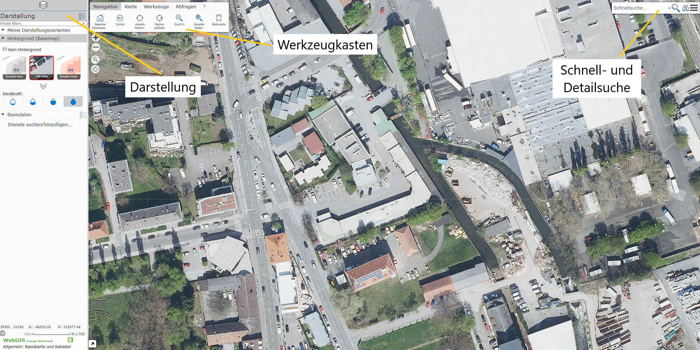
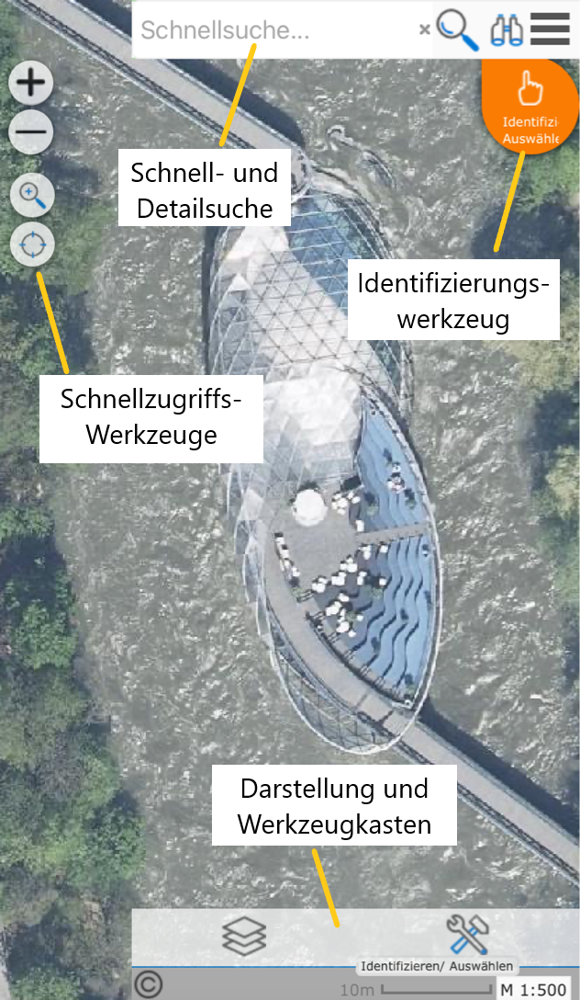

User Interface
==================

After opening a map, the map viewer appears in the following form:

Not all elements shown here need to be visible in a given map. The individual elements are set by the map administrator
so that efficient operation is possible for the respective application.

On mobile devices, the appearance adapts accordingly:

The user interface can be customized in terms of display/design. To do this, go to the settings under *Display/Design*.

.. image:: img/einstellungen.png
    :width: 300px
    :height: 250px

.. image:: img/umstellung_stand_prof.png

| Here you can customize the *color scheme*, *layout template*, and *styling*.
| For the layout template, you can choose between *Mobile (Standard)* and *Desktop (Professional)*. The desktop template offers a more user-friendly interface, especially for users who do a lot of editing.

.. _ui-detachable-windows:

Areas in a separate window
--------------------------

.. versionadded:: 9.26.4104

In the desktop template, the *toolbar* and the *query results* (table) can be detached into a
separate window, provided the map administrator has enabled this feature and the browser
supports it (Chrome, Edge). To do this, click the detach icon in the respective area. The
window can be moved freely and, for example, enlarged on a second screen.

- In the detached toolbar, all tools are shown on one page; the former tabs become headings.
- Bringing it back: via the icon in the title bar of the area, via the placeholder in the main
  window, or by closing the window.
- If a tool (e.g. *Print map*) hides the toolbar, the window shows a hint. The button
  *Close active tool* ends the tool and shows the toolbar again.
- The next time the map is opened, you are asked whether the last detached areas should be
  restored.
