.. sectnum::
    :start: 3

Presentation and Map Content
=============================

Different maps have different content. For example, a map with cadastre data and another with data from zoning are both conceivable.
Of course, a map could also cover both topic areas. The map author determines what content is in a map. Only the general
concepts of how the presentation of map content can be organized, and how the user can influence it, are described here.

The map content is mainly set in the map viewer in the **Presentation** area (usually in the left *frame* on desktop, at the bottom of the screen on mobile devices - see overview).

There are generally different types of geodata that can also be handled in different ways in the map viewer:

Dynamic Content
------------------

Dynamic content is usually very specific data and is not present in every map. It is usually shown at the very top of the list of presentation content and can be shown or hidden separately.
Dynamic content is shown on the map as clickable markers. Only one of these topics can be shown on the map at any given time.

.. image:: img/dyn_inhalte1.png

Dynamic content usually serves to provide very dynamic topics (which can change quickly) on a map.
Since it is shown on the map as markers, it behaves like the results of a query/search, and can therefore also be understood as a predefined query.
Queries/searches will be covered in more detail in a later section.

Background (Basemaps)
----------------------

This data is more static and mainly serves for orientation on the map. It is usually located below all other data on the map (background).
This background data is usually aerial imagery or town and street maps. The data is usually area-filling, so only one
background can be shown at a time.

In the presentation area of the map viewer, the background maps appear roughly as follows:

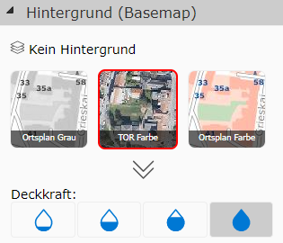

Clicking on one of the tiles switches the background. The *No background* button sets all background maps to *invisible*.
If there are more than three possible background maps, the tile view can be expanded with the arrow icon (down arrow below the tiles).

The *xx% buttons* indicate the transparency of the displayed background.

.. note:: The transparency makes the background appear "lighter," which can lead to better contrast for some applications when overlaid with thematic data.

Optional background maps (so-called *overlay* maps) can, if available, be placed over the actual background map (here *Street Colors*).
This makes sense, for example, if streets and street names should be placed over an aerial imagery map for orientation:

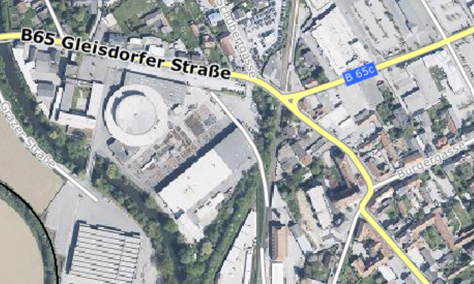

.. note::
   Since background maps usually contain static data, they are available as so-called map tiles. These tiles already exist pre-calculated on the server for all scales,
   which makes the display particularly performant and provides *smooth* transitions when navigating the map.

Presentation Variants (Thematic Data)
-------------------------------------

This is the data that is actually decisive for a map application. Unlike background maps, this data is generally not pre-processed for all scales, but
is generated individually for each map extent based on the user's requirements. This data is therefore more similar to *dynamic content* (see above), with the difference that here on the map
not only *clickable* map markers are shown. Instead, this data appears as a cartographically processed map image that is placed over the background maps.

As a result of this, this data is naturally not shown as *smoothly* as, for example, the pre-calculated background map tiles. In return, however, the user
can have significantly more influence on the content and presentation of this data. The user can decide which data layers should be shown and which should not. A wide variety of data layers can be combined as desired using
presentation variants.

.. note::
   Because the *thematic data* map images are generated dynamically and individually for each user request, it can happen that the display takes
   a few moments after the map extent is changed. The performance of these services depends on the amount of data shown and the cartographic complexity of the maps. The map viewer therefore shows
   a progress indicator in a status bar (bottom left):

   .. image:: img/hourglass1.png

   Once all data has loaded, the progress indicator disappears and the current scale and the scale bar are shown in its place:

   .. image:: img/scale1.png

   **Tip:** clicking on the scale opens a dialog in which the current map scale can be set.

In the map viewer, the presentation variants are organized in expandable containers in the *presentation frame*. Which presentation variants are available depends on the content of the map and the
respective permissions.

.. image:: img/presentations1.png

The containers contain the *toggleable* presentation variants for each topic group. The figure also shows that these presentation variants can be further subdivided into groups within a container (Base Data),
(Cadastre, Administrative Data). Once this group is expanded, the *clickable* presentation variants appear:

.. image:: img/presentations2.png

The presentation variants can be shown with different icons:

* **Layer stack icon:** clicking on the presentation variant makes the corresponding layers visible. Clicking on a layer stack usually affects several layers. Other layers that do not make sense for this view are hidden. In the example here, for instance, the cadastre is hidden in gray colors when you click on the presentation variant with the cadastre in "magenta" colors.

* **Checkbox icon:** the *checkmark* icon can be used to show or hide optional presentation variants. Several data layers can also be behind this presentation variant, logically grouped into one presentation variant.

* **Option box icon:** a *radio button* icon can be used (just like the *checkmark* icon) to optionally show topics. The difference here is that these topics are mutually exclusive. Only one *option box* can be active within a group.

.. note::
   How the presentation variants are organized, and which data layers they show, is defined by the map author. The presentation variants should help the user reach their goal as easily as possible,
   without needing exact knowledge of the underlying data structure. For example, the user may only want the option to show the cadastre. However, it doesn't matter to them
   whether that involves the topics parcel boundaries, usage boundaries, building boundaries, usage symbols, parcel numbers, ...

.. note::
   Some presentation variants are listed in *gray*. This means that the topic layers that can be shown with them are not visible at the current scale (a click will not immediately show the
   desired topics on the map). If you zoom further into the map, these topics will eventually become visible, and the presentation variant will no longer appear *gray*.

The reason for the scale-dependent display is usually that not all topics make sense at every scale. Parcel boundaries, for example, don't make sense at a very small scale (e.g. an entire federal state)
and would only slow down the map build-up.

.. _toc-context-menu:

Context Menu in the Table of Contents
-------------------------------------

.. versionadded:: 9.26.4104

Every presentation variant and every group in the table of contents has a context menu. It can be opened in two ways:

* **Right mouse button** on the presentation variant or on the title of the group.
* **Menu icon** (three lines): it appears on the right as soon as you move the mouse over a presentation variant or a group.

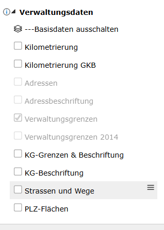

On touch devices, the context menu is opened by long-pressing an entry.

Depending on the presentation variant, its context menu contains:

* **Metadata:** opens the metadata of the presentation variant (only if provided by the map author).
* **Query Builder:** opens the Query Builder, which can be used to filter the layers of the presentation variant (only if the layers are queryable).
  If the presentation variant refers to several layers, a single layer can be chosen in the submenu. **All** opens the Query Builder for all layers of the presentation variant.
* **Reset filter:** removes all filters (e.g. from the Query Builder) of the layers of this presentation variant (only if filters are set).
* **Presentation:** changes the presentation (symbology) of a layer (see :ref:`toc-user-renderer`).
* **Labeling:** changes the labeling of a layer (see :ref:`toc-user-labeling`).
* **Properties:** opens the properties dialog (see below).

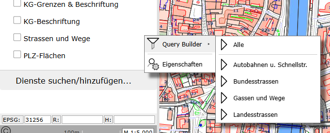

**Presentation** and **Labeling** are only offered if the map author has allowed this for the service. If the presentation variant refers to several layers,
the layer is chosen in a submenu, as with the Query Builder.

.. image:: img/toc_menu_userrenderer.png

.. _toc-querybuilder:

Query Builder
~~~~~~~~~~~~~

The Query Builder is used to compose a filter from one or more conditions. Each condition consists of **Field**, **Operator** and **Value**;
several conditions are combined with **AND** or **OR**. **Apply** only displays the features that match the filter.

.. versionadded:: 9.26.4104
   As soon as a field is selected, the Query Builder helps entering the value, depending on the type of the field:

   * **Text fields:** matching values of the layer are suggested from the first character on (values containing the entered text, at most 20).
   * **Number fields:** if the layer contains only a few distinct values (at most 25), they can be chosen from a list. Otherwise the number
     is entered directly. For numbers, the operators ``<``, ``>``, ``<=`` and ``>=`` are available as well.
   * **Date fields:** the date is selected in a calendar. Here, too, the operators ``<``, ``>``, ``<=`` and ``>=`` are available,
     e.g. for *all features before 30.06.2024*.

   The suggestions do not take the filter already set for the layer into account, so that an existing filter can also be extended.
   Suggested values are currently only available for layers of ArcGIS services; for other services, the value is entered without suggestions.

.. _toc-badges:

Badges
~~~~~~

.. versionadded:: 9.26.4104

A small rounded box (badge) to the right of the name of a presentation variant indicates that something special applies to the presentation variant:

* Color scheme icon: a custom presentation is active,
* Label icon: a custom labeling is active,
* Funnel: a filter (e.g. from the Query Builder) is set,
* *i*: metadata is available for the presentation variant.

When moving the mouse over the badge, the meaning of the icons is shown as a tooltip.

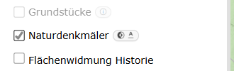

Clicking the badge does **not** switch the presentation variant on or off, but opens the context menu. There you will find the matching entries,
e.g. **Metadata**, **Reset filter**, **Reset presentation** or **Reset labeling**.
If the name of a presentation variant is very long, it is shortened so that the badge remains visible.

.. _toc-user-renderer:

Presentation
~~~~~~~~~~~~

.. versionadded:: 9.26.4104

The **Presentation** menu item can be used to change the symbology of a layer for your own map. The dialog offers two options:

* **Default (presentation of the service):** the layer is displayed as defined in the service.
* **Custom:** a new presentation is defined for the layer.

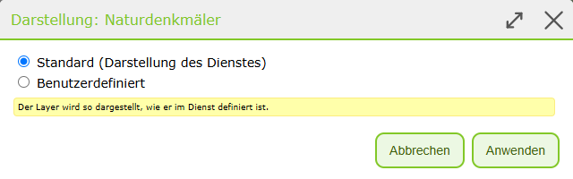

For a custom presentation, first choose the **Renderer**:

* **Single symbol:** all features of the layer are displayed with the same symbol. Depending on the geometry (point, line, polygon),
  color, size, symbol, line style and width or fill and outline can be set.

  .. image:: img/renderer_simple.png

* **Unique values:** the features are displayed differently according to the values of a field. After selecting the **Field**, **Load values**
  takes over the values occurring in the layer, or single values can be entered manually with **Add value**. For each value, the symbol
  and a **Label (legend)** can be defined. With **All other values**, features whose value does not occur in the list are displayed as well.
  If a filter is set for the layer (e.g. via the Query Builder), **Load values** only takes over the values of the filtered features.

  .. image:: img/renderer_uniquevalue.png

* **Classes (value ranges):** the features are displayed according to value ranges of a numeric field. After selecting **Field**, **Number of classes**
  and **Color ramp**, **Calculate classes** creates classes of equal size between the smallest and the largest value of the field.
  The class breaks, symbols and labels can be adjusted afterwards. If a filter is set for the layer, the smallest and largest value
  are only determined from the filtered features.

  .. image:: img/renderer_classbreaks.png

The same fields are available that can be used to filter with the Query Builder.
**Apply** draws the map with the new presentation. The legend also shows the custom presentation;
for *Unique values* and *Classes*, the field used is shown in brackets after the layer name, so it is clear what the classification is based on.

If a custom presentation is active, the **Presentation** menu item is marked with a check mark and the additional menu item
**Reset presentation** appears, which switches back to the default presentation of the service.

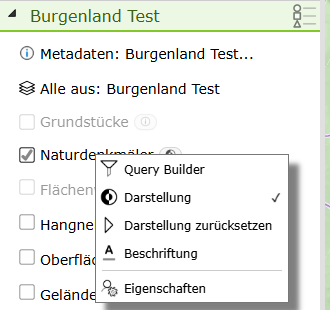

Custom presentations are saved with the map and restored when the map is loaded.

.. _toc-user-labeling:

Labeling
~~~~~~~~

.. versionadded:: 9.26.4104

The **Labeling** menu item can be used to change the labeling of a layer. The dialog offers three options:

* **Default (labeling of the service):** the layer is labeled as configured in the service.
* **No labeling:** the layer is not labeled, even if labeling is configured in the service.
* **Custom:** a custom labeling is defined.

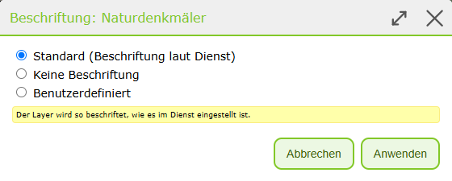

For a custom labeling, enter the **Label text**. Fields are specified in square brackets,
e.g. ``Area: [AREA] m²``. **Insert field...** inserts a field at the current position in the text. The same fields are available
that can be used to filter with the Query Builder. The text may consist of at most 3 lines and 200 characters.

Furthermore, **Font size**, **Font style** (Regular, Bold, Italic, Bold italic), **Font color** and a **Halo** can be set.

.. image:: img/labeling_custom.png

**Apply** draws the map with the new labeling. If a custom labeling is active, the **Labeling** menu item
is marked with a check mark and the additional menu item **Reset labeling** appears.
Custom labelings are saved with the map as well.

Example: natural monuments with a custom presentation (classes by year of protection) and the labeling ``[Baum]`` / ``seit [Jahr_Unterschutzstellung]``:

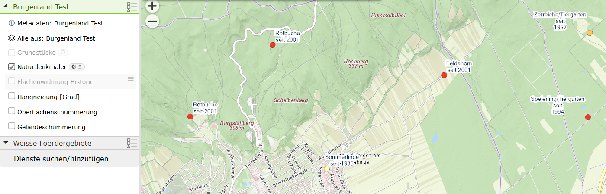

.. note::
   Labeling replaces the former *Labeling Topics* tool.

The context menu of a group contains the **metadata** of the group (if available) and the **properties**:

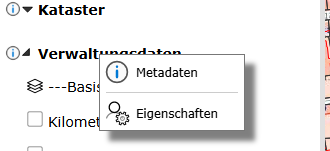

.. _toc-properties:

Properties
~~~~~~~~~~

The properties dialog summarizes the most important information about a presentation variant in several tabs:

* **General:** name, description and services of the presentation variant, as well as a list of all layers with

  * *Visible:* whether the layer is currently switched on,
  * *Scale:* in which scale range the layer is displayed (e.g. *from 1:10,000*). Layers that are not visible at the current scale are shown in gray.
    **Zoom to visible scale** zooms to the nearest scale at which the layer is visible (the map center is kept),
  * *Queryable:* whether a query exists for the layer,
  * *Filter:* whether a filter (e.g. from the Query Builder) is currently set for the layer. **Remove filter** removes the filter for this layer.
    If several layers are filtered, **Remove all filters of this theme** removes all filters at once.

  .. image:: img/toc_props_general.png

* **Legend:** the legend of all layers of the presentation variant, including those that are currently not visible.
* **Info & Copyright:** description and copyright of the services.
* **Technical:** only visible to map authors. Shows the ID of the presentation variant (*dvid*), the ID and type of the services and, for each layer,
  the ID, the full layer name, the minimum/maximum scale and the ID of the query. The values can be copied to the clipboard using the copy icon
  that appears when hovering over a row.

  .. image:: img/toc_props_technical.png

For a group, the properties dialog shows the name of the group, the contained presentation variants (visible, visible at the current scale, filtered)
and a combined legend of all layers of the group:

.. image:: img/toc_props_group.png

Tips and Tricks
----------------

Maps with a lot of thematic data can have quite extensive presentation-variant trees. Depending on experience, several clicks may be needed to find a presentation variant.
To speed up this process, you can search for presentation variants in the tree. For this, there is a small input field directly above the topmost container (desktop only), labeled *Search content...*

If you enter a value here, all irrelevant presentation variants and *containers* disappear, and all relevant groups are shown expanded.

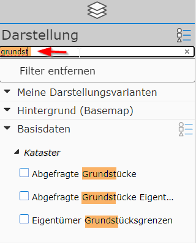

Clicking on the found presentation variant activates it, and the presentation-variant tree is shown again in its original form.
You can also click on a relevant group to open it in the original tree and show the presentation variants below it.

If you want to show the presentation-variant tree in its original form again, the content must be deleted from the *Search content* input field.

