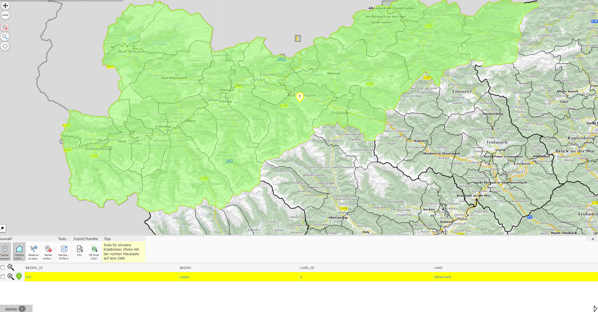
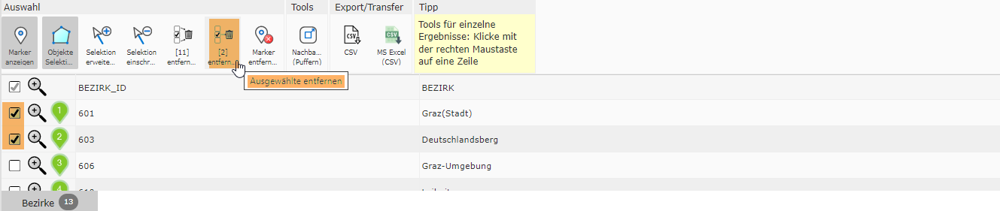
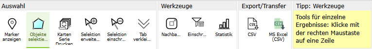
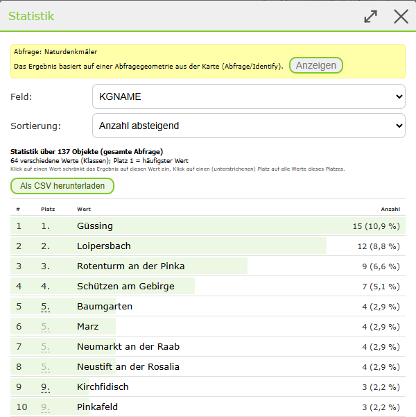
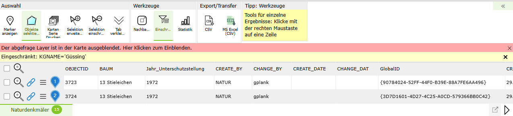
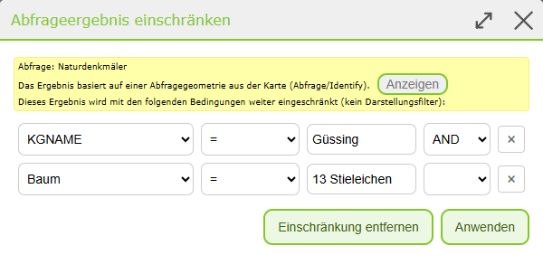
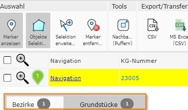
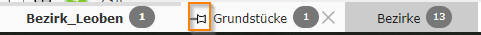

Results in Desktop Layout
============================

The result table in the desktop layout differs slightly from the table in the mobile layout.

Detail Results
----------------

The table for detail results is shown the same way as when several results are shown as a table.

Result List
-------------

.. image:: img/tabelle_liste_ergebnisse.png
    :width: 800px
    :height: 200px

Table Tools
------------------

The following table tools are available in the tables:

.. image:: img/icons_tabelle.png

The functions of the table tools are identical to those in the mobile layout.

If you select entries in a table with several results, two additional table tools appear. These are used to either remove the unselected results or to delete the selected result from the list.

.. image:: img/nicht_ausgew_entfernen.png

.. _results-query-restriction:

Restricting a Query Result
~~~~~~~~~~~~~~~~~~~~~~~~~~

.. versionadded:: 9.26.4104

If a query or identify returns too many results, the result can be narrowed down with the **Restrict** table tool.
This opens the :ref:`Query Builder <toc-querybuilder>`, where conditions (**Field**, **Operator**, **Value**) for the results are defined.

**Apply** runs the original query again. The query geometry (e.g. identify point, rectangle or buffer) and the inputs of the detail search are kept,
and the conditions from the Query Builder are added. Afterwards, the table only shows the matching results.

* The Query Builder shows where the result comes from, e.g. from a query geometry or from a detail search with the entered values.
  **Show** briefly displays the query geometry in the map.
* A restricted result is marked with a hint in the table. The restriction can be removed with the **×** in the hint or with
  **Remove restriction** in the Query Builder. The original query is then run again without the restriction.
* For slow services, a loading indicator is shown while the query runs; the buttons cannot be clicked again during this time.
* If the query with the conditions returns no results (or a condition is invalid for the field), a hint is shown.
  The Query Builder stays open with the entered conditions and the table remains unchanged.
* If the table was opened via the context menu of the table of contents (see :ref:`toc-table`), the result is based on all
  features of the layer (including active display filters); this is also shown in the Query Builder.

.. note::
   The restriction only affects the query result in the table. It is **not a display filter**; the way the layer is drawn in the map does not change.
   The tool is only available if the Query Builder is allowed for the service and fields are enabled for it.

.. _results-query-statistics:

Statistics for a Query Result
~~~~~~~~~~~~~~~~~~~~~~~~~~~~~

.. versionadded:: 9.26.4104

The **Statistics** table tool gives an overview of a field of the query result, e.g. how many features exist per material
or which is the oldest or newest year of construction. An export to Excel is no longer necessary for this.

The statistics are calculated by the service over the **whole query**, not only over the features loaded into the table. They are therefore correct
even if the query returns more hits than are shown in the table. The query geometry, the inputs of the detail search
and an existing :ref:`restriction <results-query-restriction>` are taken into account.

In the dialog, select the **Field** (the fields enabled for the Query Builder are offered) and the **Display**:

**Key figures** (number and date fields): count of features with a value, count empty, minimum and maximum, for number fields also average and sum.

.. image:: img/statistik_kennzahlen.png

**Count per value** (number and text fields, always for text fields): The features are grouped by the values of the field. Above the list, the number of distinct values (classes) is shown.

The list has the following columns:

* **#**: consecutive row number.
* **Rank**: rank of the value by its count, rank 1 is the most frequent value. Values with the same count share the same rank,
  and the next rank is skipped accordingly (e.g. 1, 2, 2, 4). A repeated rank is shown faded.
* **Value**: the value of the field. Empty values are shown as *(empty)*.
* **Count**: number of features with this value and their share of the whole result.

**Sort order** sorts the list by count in descending (default, rank 1 at the top) or ascending order.

If the service does not return all values (the number of values is limited by the service), a hint below the list shows
how many features have further values that are not listed.

**Download as CSV** downloads the displayed statistics as a CSV file (separator ``;``), e.g. for further processing in Excel.

Restricting the Result via the Statistics
^^^^^^^^^^^^^^^^^^^^^^^^^^^^^^^^^^^^^^^^^

In the **Count per value** display, the query result can be restricted directly from the statistics:

* Click on a **value**: the result is restricted to all features with this value (e.g. ``KGNAME = Güssing``).
* Click on an (underlined) **rank**: the result is restricted to all values of this rank (e.g. ``KGNAME in (value1, value2, ...)``).

Afterwards, the table only shows the matching features and a hint about the restriction:

If a restriction already exists, the new condition is added with **AND**. This way, the result can be narrowed down step by step.
The statistics then show the current restriction:

.. image:: img/statistik_eingeschraenkt.png

In the Query Builder (**Restrict** tool), single conditions can be removed again with the **×**, e.g. to restrict by a different value.
**Apply** queries the result again with the remaining conditions.

.. note::
   Statistics are only available for layers of ArcGIS services that support statistics queries, and only if the Query Builder is allowed for the service.
   For date fields, only the key figures are shown. Restricting to a rank is not possible if it contains empty values or values with a comma,
   or more than 1000 values.

Table Tabs
-------------

Another difference from the mobile layout is the presence of tabs. A tab opens for each query topic. The number of results is shown to the right of the tab label.

If you query a topic again, the previously provided tab is replaced by the updated query result. How to prevent already-open tables from being closed by a new query is described in the next subchapter.

Results History
-------------------

There is no classic history like in the mobile layout in the desktop layout. Instead, it is possible to pin the tabs. To do this, click on the pin icon to the left of the label.

Then, an individual description must be entered into the label field.

Pinning prevents these results from being lost. It is also possible for the table to be shared as well when using *Share Map*.
