Special Tools
================

In addition to lines, polygons, freehand, text, rectangles, and circles, there are also more specialized graphics, which are covered here.
Most of them can be found in the *Measure* tool group (see :ref:`Tool Groups <mapmarkup-tool-groups>`).

The following applies to all measuring tools:

* The exact click sequence is described for the selected tool in the *Symbology* panel (highlighted in yellow).
* The properties (unit, angle, distances, ...) can be set before drawing. The most recently
  chosen values are reused for further elements of the same type.
* Lengths, areas and angles are calculated in the coordinate system of the map (see the note on the
  :ref:`dimension line <mapmarkup-measure-dimline>`).
* The elements are printed as they are shown on the map and can be downloaded as a shape file.
  The measured values (lengths, angles, units, ...) are included as attributes.

Buffer Circle
--------------

With this tool, a circle with a certain radius around a center point can be defined. In addition to the actual buffer circle, circles with intermediate steps are also shown and labeled:

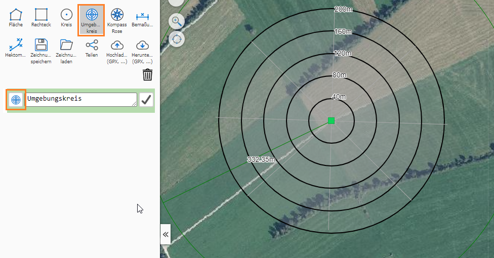

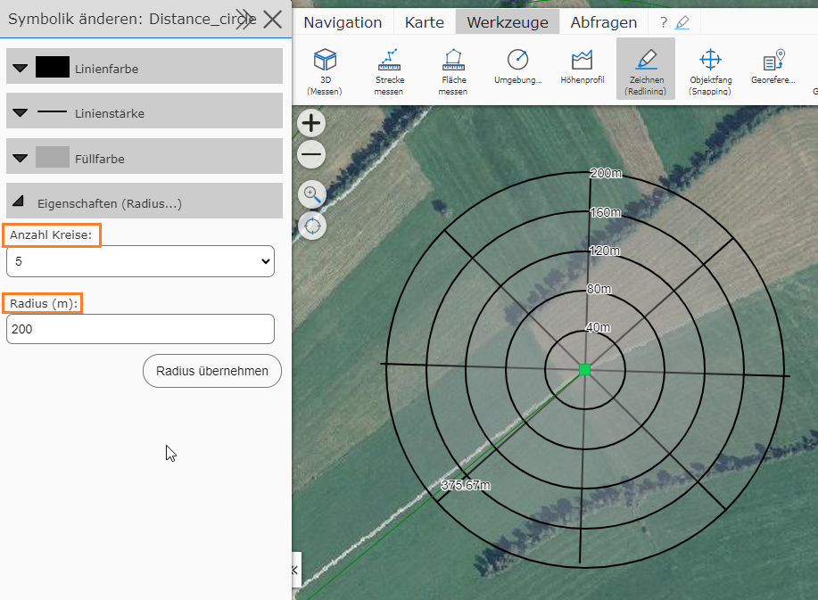

The result can be used for distance analyses.

.. _mapmarkup-measure-dimline:

Dimension Line
--------------

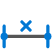

With this tool (*Dimensioning*), a (poly)line can be drawn, in which each segment is labeled with its corresponding length in meters:

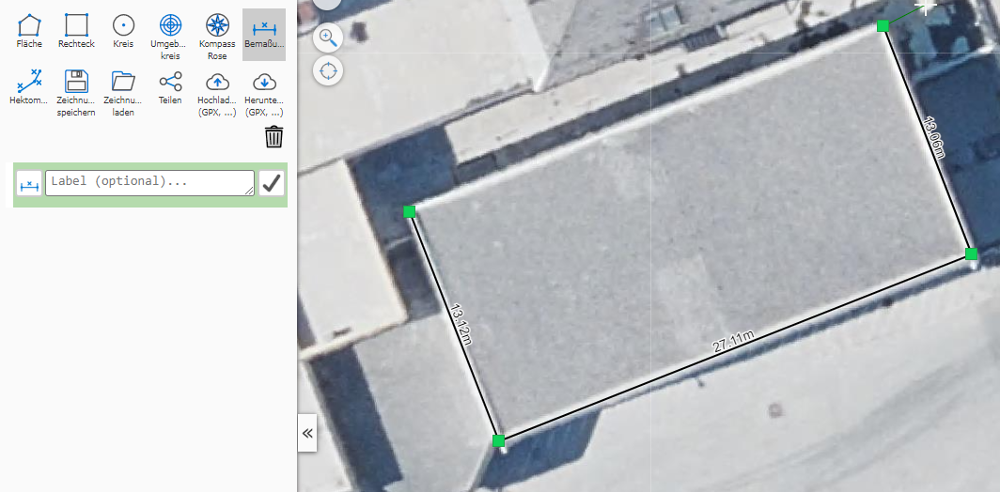

Optionally, angles are labeled as well. To do so, choose the unit under *Show angles* in the properties
(*None*, *Degrees*, *Gon* or *Degrees and gon*). *Angle type* defines which angle is shown:

* **Interior angle:** the angle between the two segments at each intermediate vertex (0° to 180°)
* **Deflection angle (L/R):** the change of direction at each intermediate vertex, with ``L`` (left) or ``R`` (right);
  the incoming segment is extended with a dashed line
* **Azimuth:** the angle of each segment from (grid) north, clockwise (0° to 360°);
  a dashed north line is drawn for this

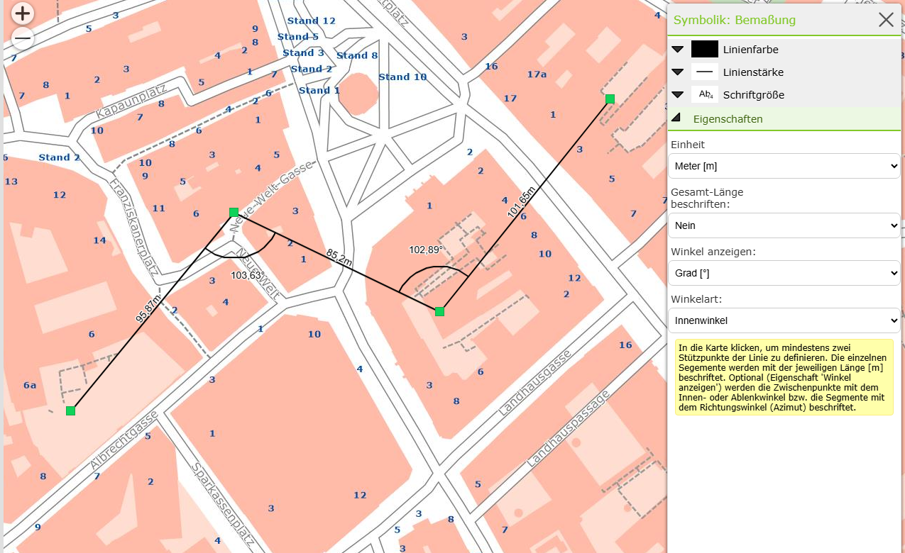

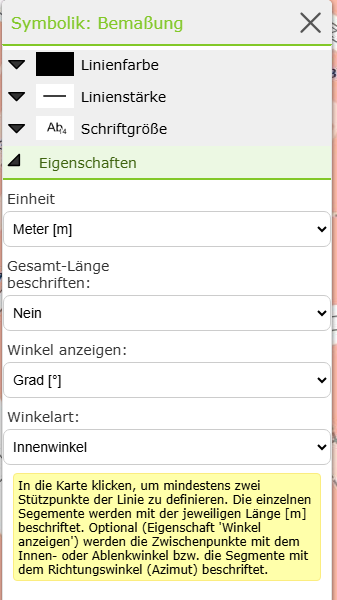

Dimension lines from already existing drawings are still shown without angles.

.. note::
   The length shown is always calculated *live* from the vertices in the current map coordinate system. If you transfer the drawing (by saving and loading) into a map with a different coordinate system,
   the values may differ. This applies particularly to all maps that use *WebMercator*, since there can be significant distortion here. Which coordinate system is used can be read
   at the bottom left of the *map viewer*.

   .. image:: img/advanced-tools3.png

.. _mapmarkup-measure-dimpolygon:

Dimension Polygon
-----------------

Like the dimension line, but for polygons: each edge is labeled with its length, the polygon with its area.
Here too, the interior angles at all corners (0° to 360°) can be labeled in degrees, gon or both under *Show angles*.

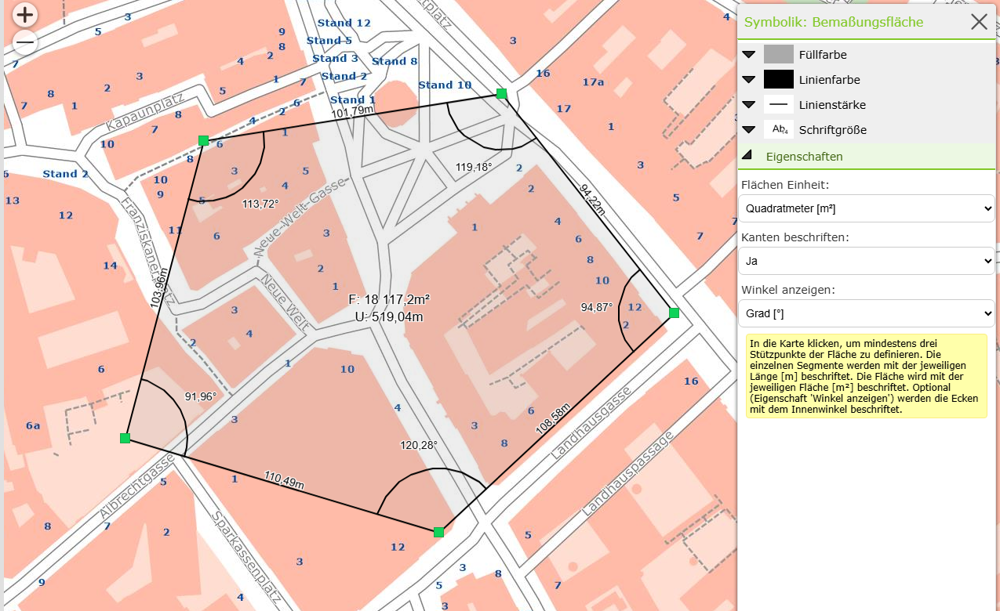

Chainage Line
---------------------

With this line, intermediate points are marked and labeled at a predefined distance (e.g. every 100m):

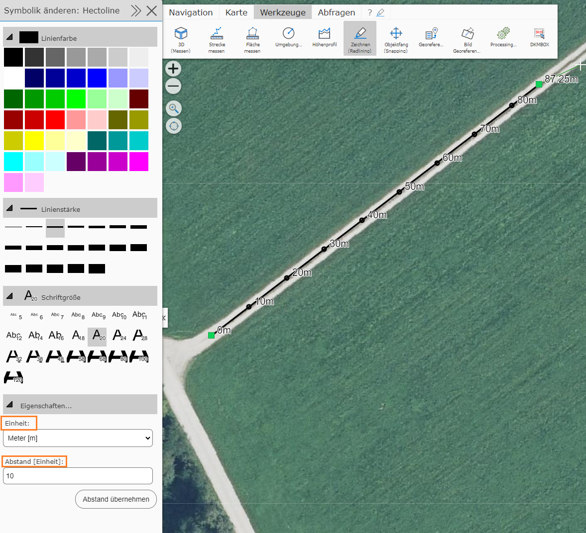

Meters [m] and kilometers [km] can be specified as the display unit.

.. note::
   Just as with the dimension line, the distance points here are also calculated *live* and always relate to the current map coordinate system. If you insert the drawing into different maps, deviations may occur!

.. _mapmarkup-measure-view-angle:

Field of View (Angle)
---------------------

Draws a view cone with a given opening angle, e.g. for the field of view of a camera or a window.

* 1st click: vertex, 2nd click: direction and length of the axis. Further clicks only move the end of the axis.
* Properties: *Opening angle* (default 30°, set with *Apply angle*), unit (degrees, gon or both)
  and optionally labeling the axis length.

The total opening angle and the two half angles to the left and right of the axis are labeled.

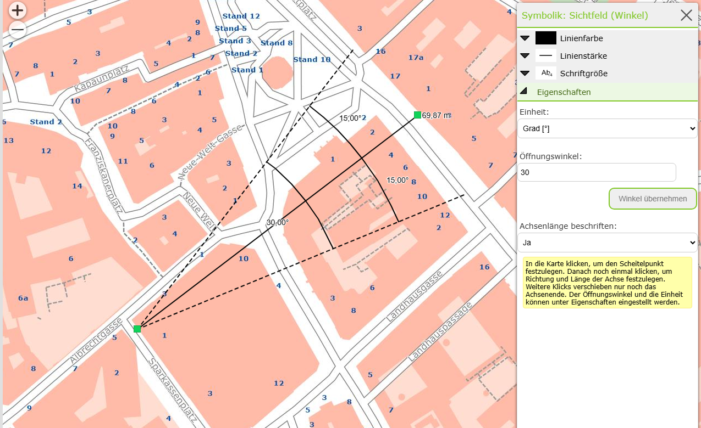

.. _mapmarkup-measure-intersection-angle:

Intersection Angle
------------------

Measures the angle at which two lines intersect, e.g. road axes or pipelines.

* Define the first line with two clicks and the second line with two further clicks. Further clicks only move
  the end point of the second line.
* If the intersection point lies outside the drawn lines, they are extended with dashed lines.
  Parallel lines are labeled *parallel*.
* *Show angles* defines which angles are labeled: intersection angle, adjacent angle
  (180° minus the intersection angle), both or all four angles at the intersection point. The unit is degrees, gon or both.

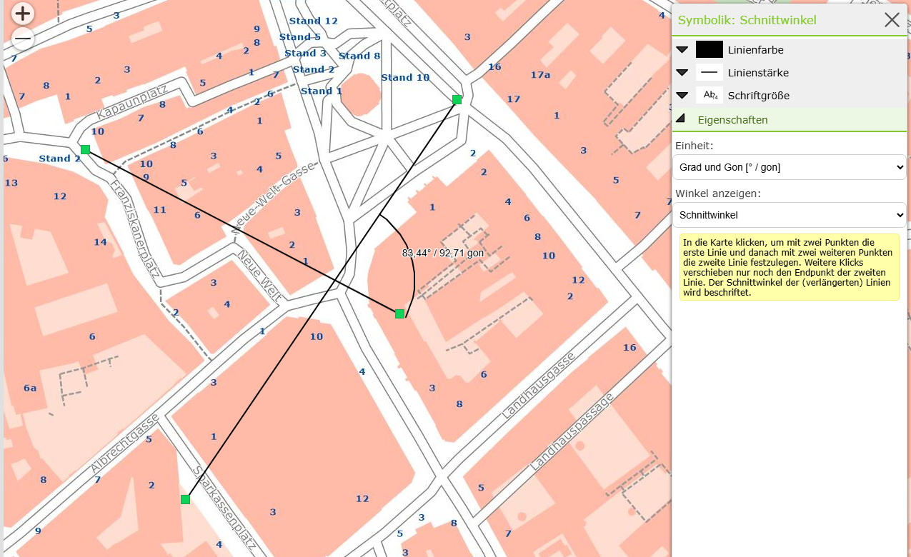

.. _mapmarkup-measure-circle-arc:

Circular Arc
------------

Draws a circular arc through three points, e.g. to determine the radius of a curve.

* Click the start point, any point on the arc and the end point. Further clicks only move the end point.
  If the three points lie on a straight line, a hint is shown.
* Radius, arc length and central angle are labeled. *Labels* defines whether all values or only one of them
  are shown; the angle unit is degrees, gon or both.

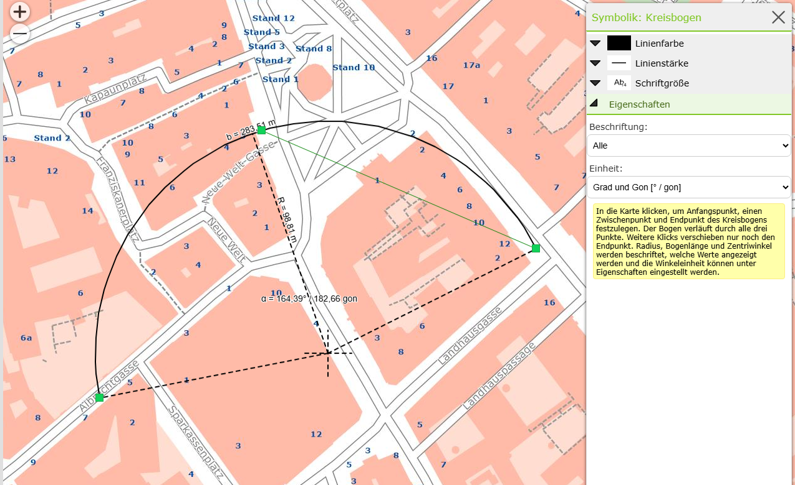

.. _mapmarkup-measure-perpendicular:

Perpendicular Distance
----------------------

Measures the perpendicular distance of any number of points to a reference line, e.g. the distance of objects to
a road axis, including the station.

* First draw the reference line and finish it with a double-click on the last point (or *Close section*
  in the context menu or the ``F`` key).
* Then set any number of points: for each point, the perpendicular to the reference line is drawn and labeled with the
  distance. If the foot of the perpendicular lies outside the line, the line is extended with a dashed line.
* Properties: *Station* of the foot of the perpendicular in meters (e.g. ``156.24m``), as chainage (e.g. ``0+156.24``)
  or none, and the *Length unit* (m or km).

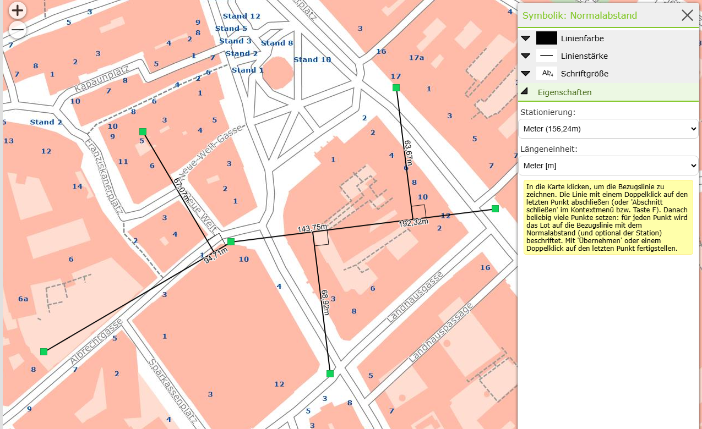

.. _mapmarkup-measure-buffer-zone:

Buffer Zone
-----------

Draws a buffer zone with a certain width around a geometry, e.g. a protective strip along a pipeline.

* Under *Source type*, choose which geometry is buffered: point, multiple points, line or polygon.
  Enter the width in meters under *Buffer width* and set it with *Apply buffer width*.
* Then draw the source geometry on the map. The buffer zone is calculated by the server and shown after a short time.
* With the source type *Point*, each further click moves the point; with *Multiple points*, each click adds a point.
* Lines and polygons can consist of several parts: *Close section* starts another part
  (e.g. a hole in a polygon).
* For polygons, a negative buffer width results in an inner buffer.
* *Take from feature geometry* takes the geometry of an object from the map (point, line or polygon,
  also multipart and with holes). The source type is set automatically.

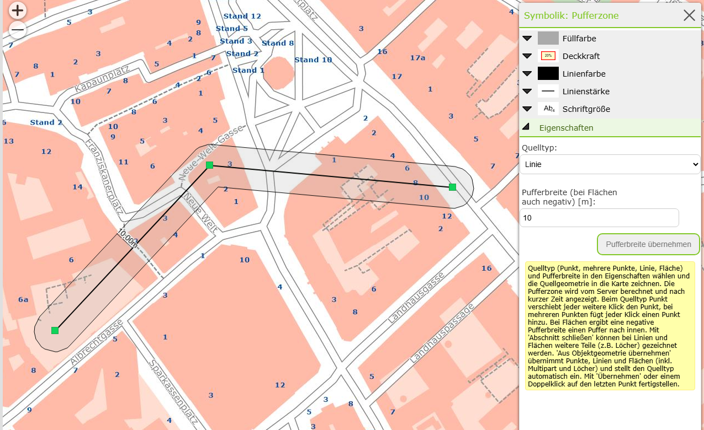

.. _mapmarkup-measure-object-distance:

Object Distance
---------------

Measures the shortest connection between objects from the map, e.g. from a building to the parcel boundary or between two pipelines.

* Click an object of a visible layer to choose the origin object (A).
* Then click any number of further objects (B): for each object, the shortest connection to A is drawn like a
  dimension line and labeled with its length. Clicking an object B again removes its line.
* If there are several objects at the click position, a selection list (*Select object*) is shown. Hovering over an
  entry highlights the object on the map.
* For polygons, the distance to the boundary is measured. If the objects touch or intersect, the distance is 0
  (no line is drawn).
* Properties: *Length unit* (m or km) and optionally numbering of the connections (*Show number*).

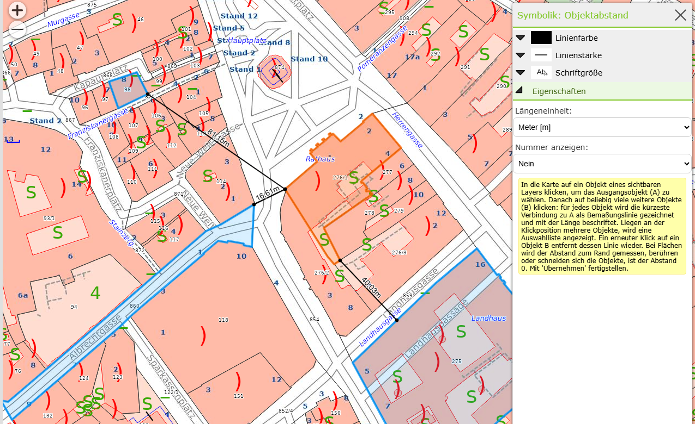

.. note::
   The distances are calculated while drawing and stored with the drawing. If the objects on the map change
   later, the stored distances are not recalculated.

.. _mapmarkup-measure-grid:

Measurement Grid
----------------

Draws a grid with a fixed cell size and labeled cells (``A1``, ``B1``, ...), e.g. for grid-based field surveys
or to reference positions in a printout.

* The first two clicks define the base edge of the grid (cell A1 starts at the first point), the third
  click defines the depth. The grid can therefore be rotated arbitrarily. Further clicks only move the last point.
* Enter the *Cell size X/Y* in meters (Y empty = same as X) and set it with *Apply cell size* (default 10 m).
* With *Align to coordinate grid*, two clicks (opposite corners) are enough. The grid is then axis-parallel and
  the grid lines lie on round coordinate values. Optionally, the *Origin* (corner of cell A1) can be set to exact
  coordinates (*Apply origin*).
* *Labels*: cells (``A1``, ``B1``, ...), border (columns/rows), coordinates (aligned grid only) or none.
* A grid can have at most 2500 cells. For larger grids, only the frame is shown together with a hint.

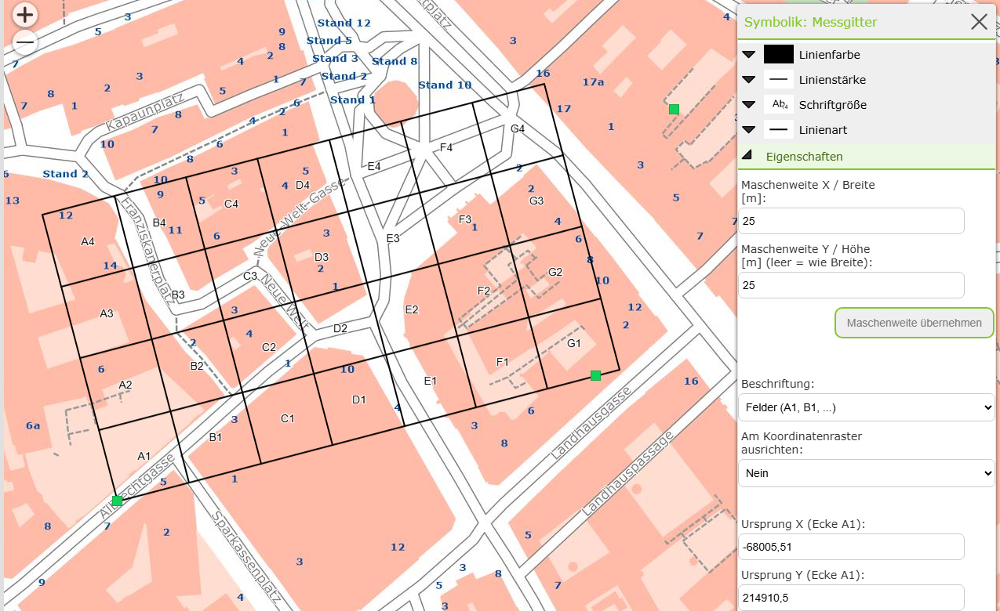

Compass
-------

A new addition to map markup is the *compass* special tool.

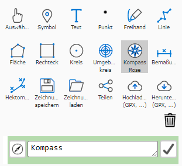

If you insert one, you have the option under *Edit symbology* to adjust the color, line thickness, and number of angles accordingly.

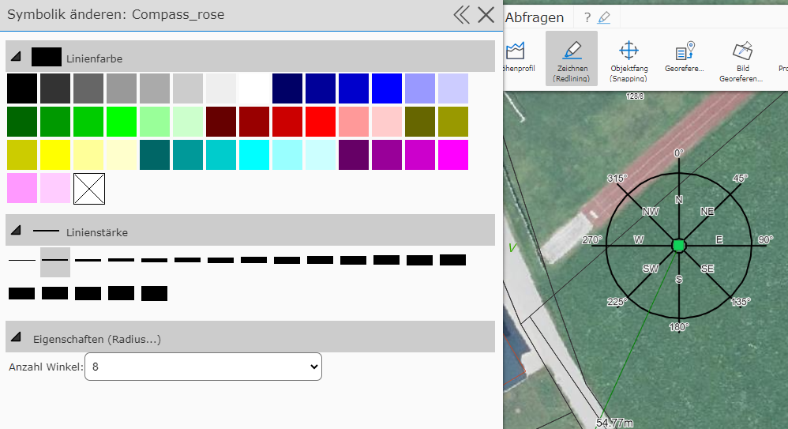

